<p align="center">
  
</p>

<h1 align="center">Orbit</h1>

<p align="center">
  <strong>A modern Matrix-powered chat, server, DM, voice, video, and screen-sharing client for Android and desktop.</strong>
</p>

<p align="center">
  
  
  
  
</p>

<p align="center">
  
  
  
  
  
</p>

## Table Of Contents

- [What Orbit Is](#what-orbit-is)
- [Project Goals](#project-goals)
- [Feature Matrix](#feature-matrix)
- [Technology Stack](#technology-stack)
- [System Architecture](#system-architecture)
- [Repository Layout](#repository-layout)
- [Source Sets And Platform Split](#source-sets-and-platform-split)
- [Domain Model](#domain-model)
- [Authentication And Session Flow](#authentication-and-session-flow)
- [Matrix Data Layer](#matrix-data-layer)
- [Messaging Flow](#messaging-flow)
- [Server, Space, And Channel Flow](#server-space-and-channel-flow)
- [Voice, Video, And Screen Sharing](#voice-video-and-screen-sharing)
- [Desktop Native WebRTC Runtime](#desktop-native-webrtc-runtime)
- [Local Storage](#local-storage)
- [UI Architecture](#ui-architecture)
- [Visual Identity](#visual-identity)
- [Build And Run](#build-and-run)
- [Developer Workflow](#developer-workflow)
- [Troubleshooting](#troubleshooting)
- [Known Limitations](#known-limitations)
- [Related Documentation](#related-documentation)
- [Regards](#regards)

## What Orbit Is

Orbit is a Kotlin Multiplatform Matrix client. It turns Matrix rooms, spaces, events,
media, profiles, verification, and VoIP signaling into a Discord-style communication
experience with servers, channels, DMs, voice calls, video calls, and screen sharing.

The project is named `Orbit`, while the Gradle root project is currently named `Onichat`.
The Android package namespace is `com.noobdev.orbit`.

Orbit is designed around a simple idea:

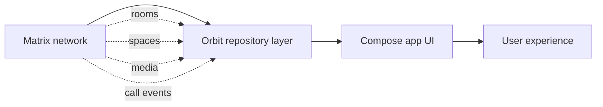

## Project Goals

Orbit aims to provide:

- A familiar server/channel/DM interface on top of Matrix.
- A single shared Compose UI for Android and desktop where possible.
- Matrix-native messaging instead of a custom closed backend.
- Real-time sync, local persistence, media upload, and media rendering.
- WebRTC voice/video calls that can interoperate with Element.
- Desktop screen sharing and native WebRTC support through bundled libraries.
- A clean repository boundary so UI code does not depend directly on Matrix SDK types.

## Feature Matrix

| Area | Current Capability |
| --- | --- |
| Authentication | Password login, SSO login, registration entry point, session restore |
| Homeserver | Works with Matrix homeservers through Matrix Client-Server APIs and Trixnity |
| Servers | Matrix spaces, room buckets, direct-message bucket, join flow, create flow |
| Channels | Text and voice channel models mapped to Matrix rooms |
| Messaging | Timeline load, live updates, local echo, text messages |
| Attachments | Image, file, and audio uploads through Matrix media |
| Rich Events | Reactions, replies, edits, deletes, unsupported-event fallback |
| Identity | Current profile, user profile lookup, display name update, avatar upload |
| Presence | Presence and typing contracts are exposed through the repository |
| Verification | Trixnity-backed device verification flow with overlay UI |
| Calls | Matrix call signaling, TURN discovery, WebRTC offer/answer/candidates/hangup |
| Video | Camera capture and remote rendering on Android and desktop |
| Screen Sharing | Desktop screen sharing, with native Windows audio-loopback work in the tree |
| Layout | Compact, medium, and expanded adaptive layouts |
| Themes | Default, light, AMOLED, ocean, forest, sunset, and cyberpunk style variants |
| Icons | Custom Orbit icon set extracted from the committed collection SVG |

## Technology Stack

| Layer | Stack |
| --- | --- |
| Language | Kotlin Multiplatform `2.0.21` |
| UI | Compose Multiplatform `1.7.3`, Material, Material 3 |
| Android | Android Gradle Plugin, compile SDK `34`, min SDK `24` |
| Desktop | JVM `17`, Compose Desktop |
| Matrix SDK | Trixnity `5.4.0` |
| Direct HTTP | Ktor `3.0.1` |
| Persistence | Room KMP `2.7.0-alpha11`, bundled SQLite `2.5.0-alpha11` |
| Media | Trixnity Okio media store, Coil `3.0.0` |
| Crypto | Trixnity Vodozemac crypto driver |
| Android WebRTC | `io.getstream:stream-webrtc-android:1.1.2` |
| Desktop WebRTC | Local `:webrtc-java-lib` project and custom native DLL resources |
| Native Helpers | `webrtc-java-fork`, Windows WebRTC runtime DLLs, JNA |

## System Architecture

Orbit keeps the app split into clear layers: UI, domain models, repository contract,
Matrix/Trixnity implementation, platform implementations, and native runtime support.

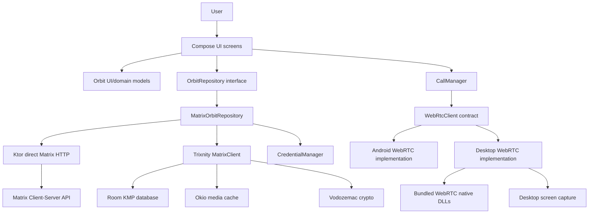

### Dependency Direction

The dependency direction is intentionally one-way:

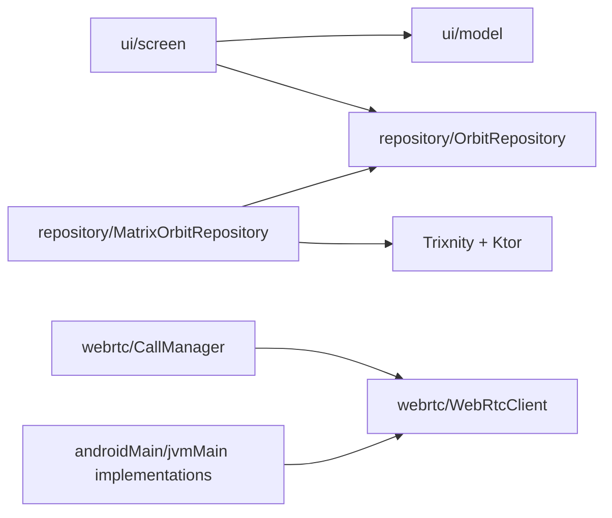

The UI should talk to `OrbitRepository` and `CallManager`, not directly to raw Matrix
SDK classes. This makes screens easier to test and keeps Matrix-specific translation in
one place.

## Repository Layout

```text
.
|-- app
|   |-- build.gradle.kts
|   |-- src
|   |   |-- commonMain
|   |   |   |-- kotlin
|   |   |   |   |-- repository        Repository contracts and Matrix implementation
|   |   |   |   |-- ui
|   |   |   |   |   |-- icons           Custom Orbit Compose ImageVectors
|   |   |   |   |   |-- layout          Window size and adaptive layout helpers
|   |   |   |   |   |-- model           OrbitServer, OrbitChannel, OrbitMessage, OrbitUser
|   |   |   |   |   |-- screen          Login, app shell, chat, calls, settings, drawers
|   |   |   |   |   |-- theme           Palette, typography, shapes, motion
|   |   |   |   |-- util              Shared expect declarations
|   |   |   |   |-- webrtc            Shared call manager and WebRTC contract
|   |   |-- androidMain
|   |   |   |-- kotlin
|   |   |   |   |-- com/noobdev/orbit Android activity, app bootstrap, screen-share service
|   |   |   |   |-- repository        Android credential/settings actuals
|   |   |   |   |-- util              Android database, media, browser, audio actuals
|   |   |   |   |-- webrtc            Android WebRTC actual implementation
|   |   |-- jvmMain
|   |   |   |-- kotlin
|   |   |   |   |-- ui/screen         Title bar, video renderer, call surfaces
|   |   |   |   |-- util              Desktop database, media, browser, audio actuals
|   |   |   |   |-- webrtc            Desktop WebRTC actual implementation
|   |   |   |-- resources          Logo, wallpaper art, selfie-segmentation model, native WebRTC DLLs
|-- webrtc-java-lib             Local JVM WebRTC library wrapper
|-- webrtc-java-fork            Custom fork/reference source for desktop WebRTC work
|-- trixnity-src                Local reference copy of Trixnity sources
|-- trixnity_sources            Additional Trixnity reference sources
|-- VIDEO_CALLING.md            Focused call-stack documentation
|-- implementation_plan.md      Backend integration notes
|-- todo.md                     Project roadmap notes
|-- Collection.svg              Source icon collection used for OrbitIcons
|-- Create_a_memorable_modern_app_202605260126.jpeg
|-- gradle/wrapper              Gradle wrapper
```

## Source Sets And Platform Split

Orbit uses Kotlin Multiplatform source sets:

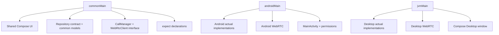

| Source Set | Responsibility |
| --- | --- |
| `commonMain` | Shared UI, shared models, repository API, Matrix repository, call state machine |
| `androidMain` | Android activity, permissions, media picker, SSO handler, Android WebRTC |
| `jvmMain` | Desktop entry point, custom title bar, desktop WebRTC, native loading |

## Domain Model

Orbit presents Matrix concepts with app-friendly names.

| Orbit Concept | Matrix Concept | Notes |
| --- | --- | --- |
| Server | Matrix space, DM bucket, or fallback room bucket | Used by the left rail |
| Channel | Matrix room | Text/voice distinction is Orbit UI metadata |
| Message | Matrix timeline event | Text, image, file, audio, reactions, replies |
| Attachment | Matrix media upload | Stored as `mxc://` URI |
| Call | Matrix call events in a room | WebRTC media is negotiated through signaling |
| User | Matrix profile and membership | Presence and display information map into `OrbitUser` |

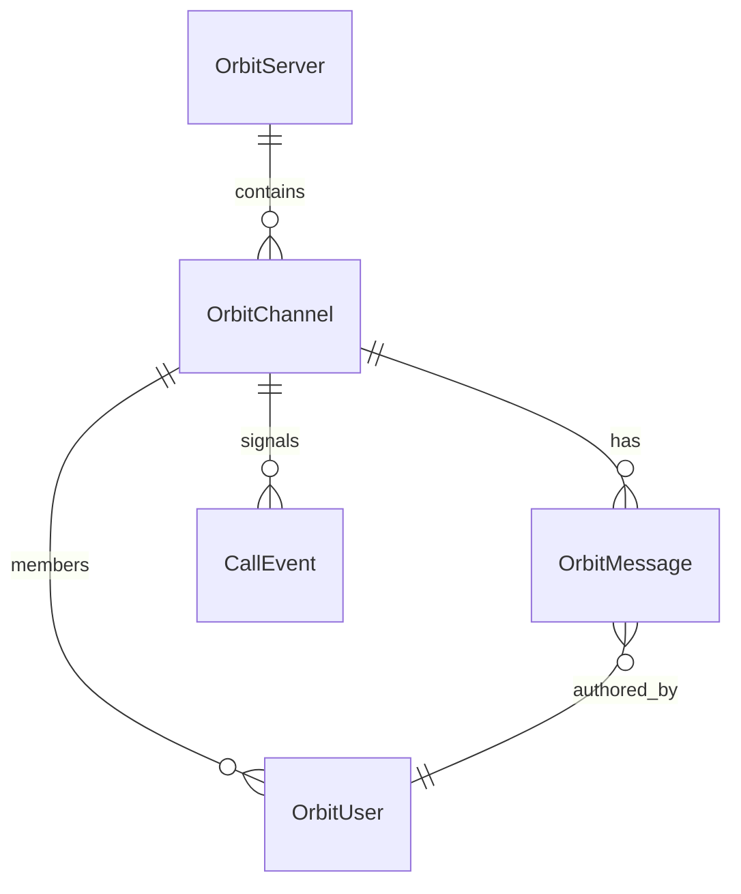

### Main Shared Models

| File | Purpose |
| --- | --- |
| `ui/model/OrbitServer.kt` | Server/space representation for navigation |
| `ui/model/OrbitChannel.kt` | Room/channel representation |
| `ui/model/OrbitMessage.kt` | Timeline message representation |
| `ui/model/OrbitUser.kt` | User, profile, presence, and display metadata |
| `repository/OrbitRepository.kt` | App-facing data contract |
| `webrtc/CallManager.kt` | Call state machine and signaling coordinator |
| `webrtc/WebRtcClient.kt` | Platform WebRTC contract |

## Authentication And Session Flow

Orbit supports password login, SSO login, registration entry points, and persisted session
restore.

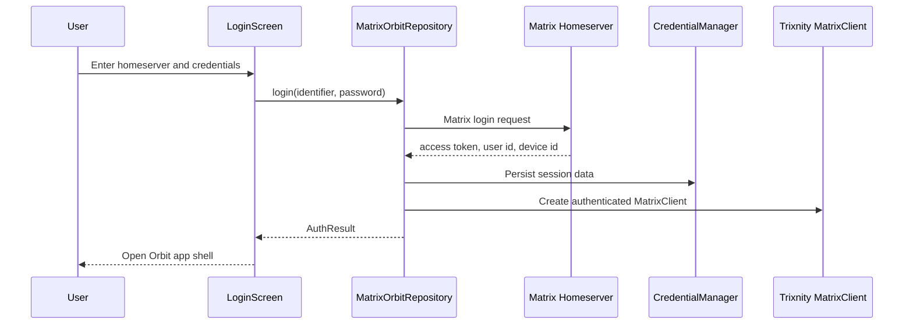

### SSO Flow

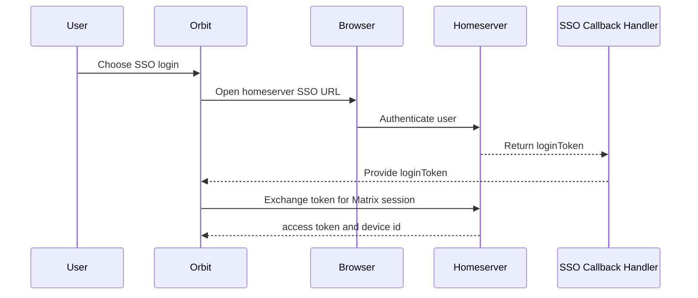

### Session Restore

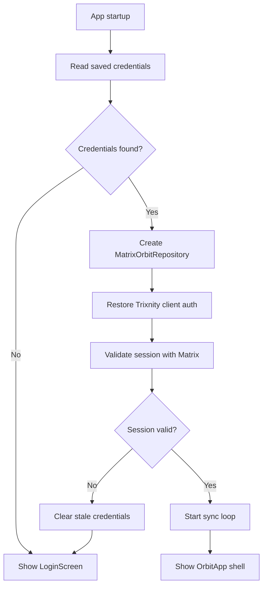

## Matrix Data Layer

`OrbitRepository` is the boundary that the UI consumes. `MatrixOrbitRepository` is the
Matrix-backed implementation that translates Orbit requests into Matrix/Trixnity calls.

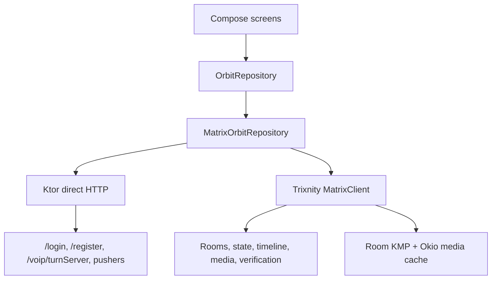

### Repository Responsibilities

| Area | Important Methods |
| --- | --- |
| Auth | `login`, `register`, `getCurrentUser`, `logout` |
| Servers/Spaces | `getSpaces`, `joinSpace`, `createSpace`, `getSpaceHierarchy` |
| Channels/Rooms | `getChannelsForSpace`, `createChannel`, `getChannelById`, `getRoomMembers` |
| Messages | `getMessagesForChannel`, `observeMessages`, `sendMessage`, `editMessage`, `deleteMessage` |
| Media | `uploadMedia`, `sendImageMessage`, `sendFileMessage`, `sendAudioMessage` |
| Identity | `updateDisplayName`, `uploadAvatar`, `getUserProfile` |
| Presence | `setPresence`, `observePresence`, `setTyping`, `observeTyping` |
| Calls | `getTurnServers`, `sendCallEvent`, `observeCallEvents`, `observeActiveCall` |
| Push | `registerPusher` |

### Matrix And Orbit Translation

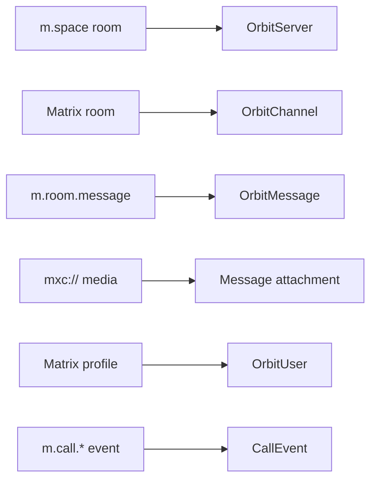

## Messaging Flow

### Sending A Message

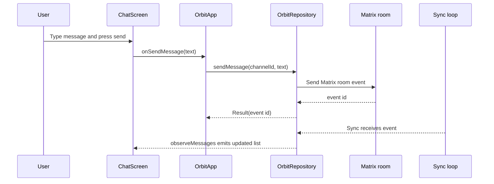

### Loading A Timeline

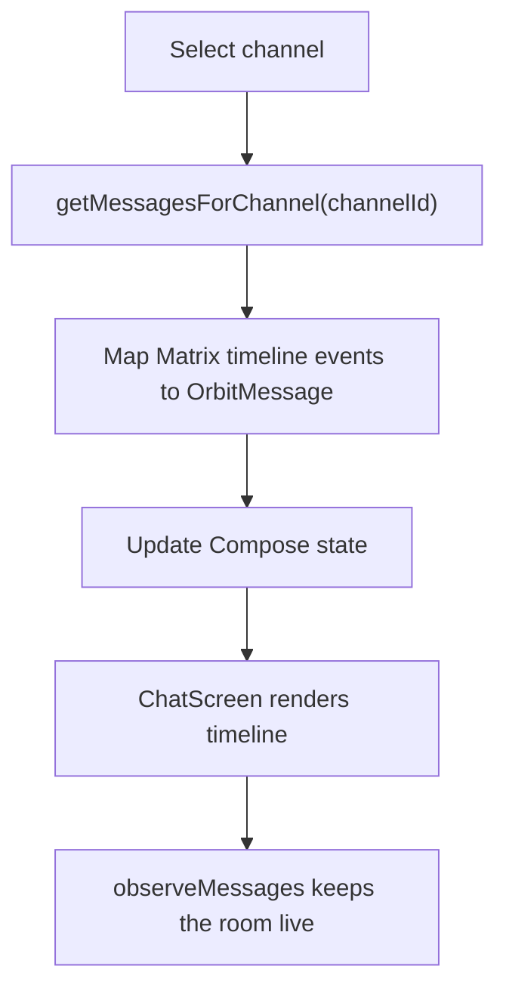

### Media Upload

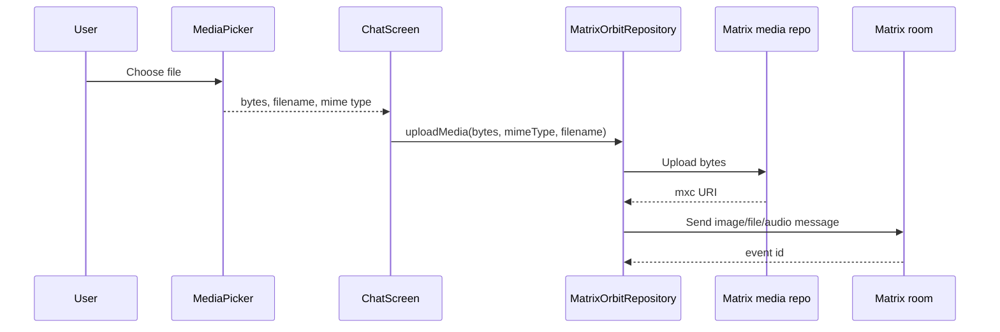

## Server, Space, And Channel Flow

Orbit treats Matrix spaces and room groupings as "servers" so the app feels familiar.

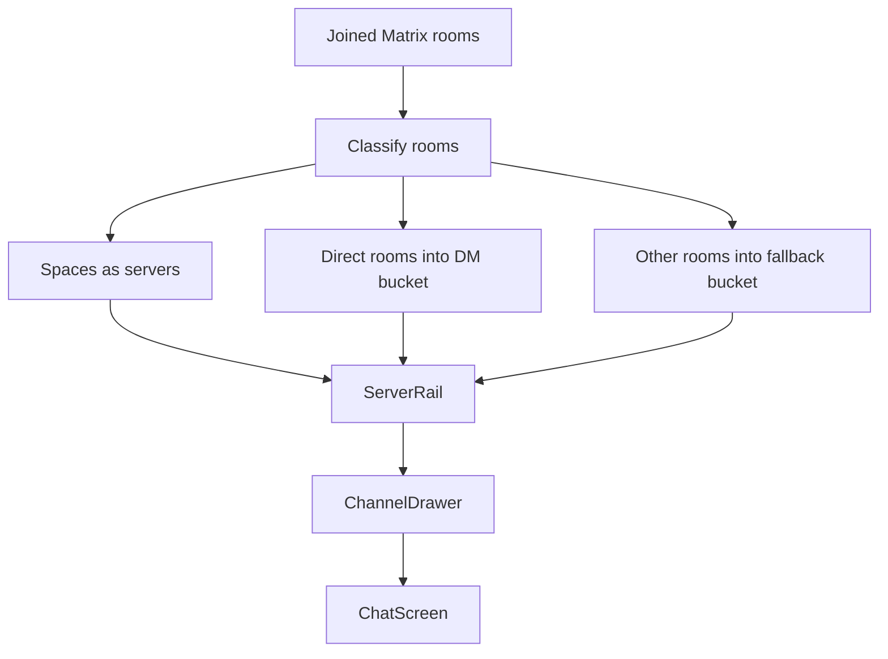

### Creating A Server Or Channel

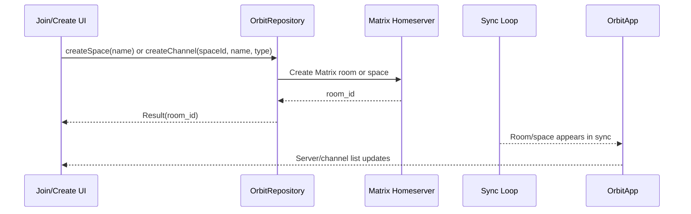

## Voice, Video, And Screen Sharing

Calls are coordinated by `CallManager`. Platform media capture and WebRTC peer connection
details live behind `WebRtcClient`.

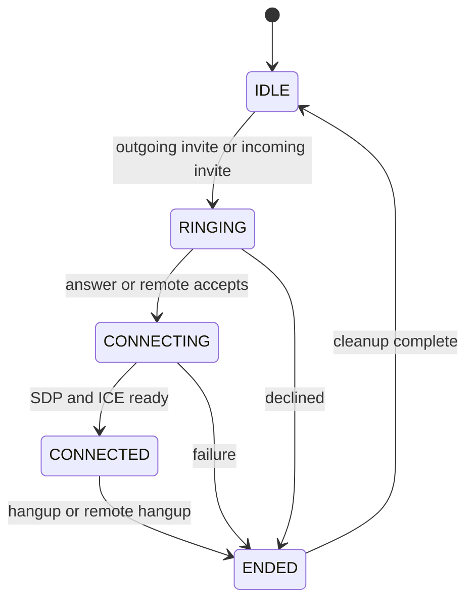

### Outgoing Call Flow

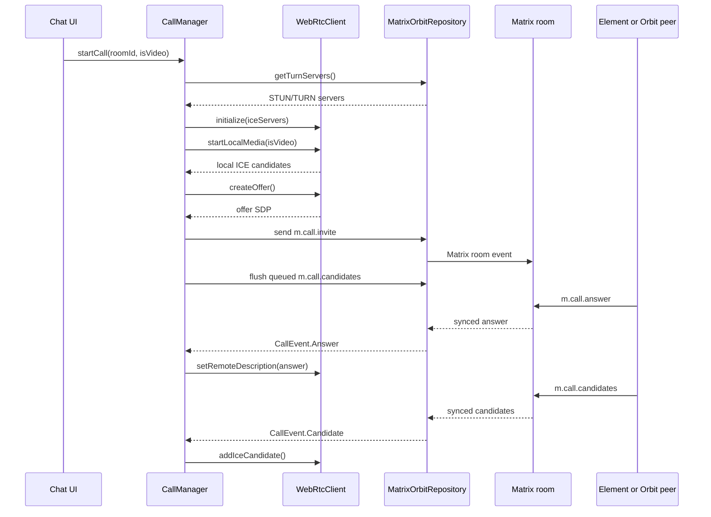

### Incoming Call Flow

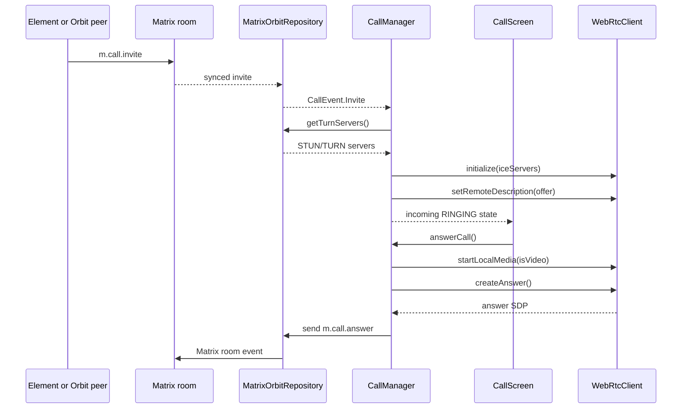

### Call Event Types

| Event | Purpose |
| --- | --- |
| `m.call.invite` | Starts negotiation and carries offer SDP |
| `m.call.answer` | Accepts invite and carries answer SDP |
| `m.call.candidates` | Sends ICE candidates for connectivity |
| `m.call.negotiate` | Used for renegotiation paths |
| `m.call.hangup` | Ends the call |

### Screen Sharing

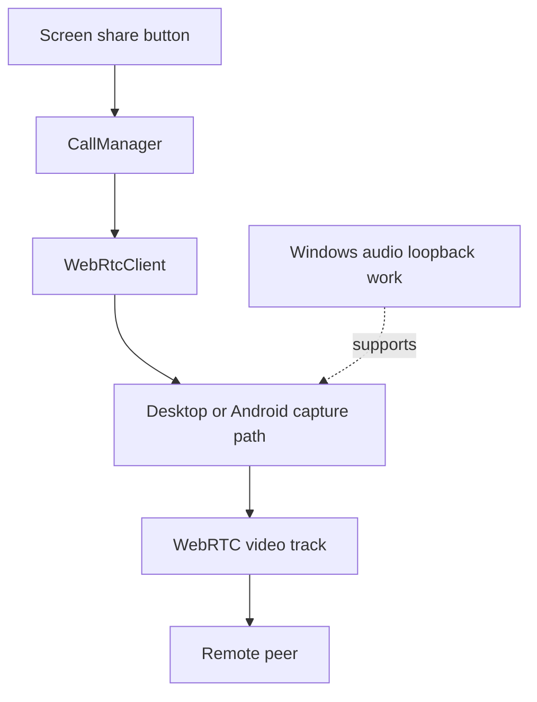

## Desktop Native WebRTC Runtime

The desktop target uses a custom local WebRTC runtime rather than relying only on the
published upstream artifact.

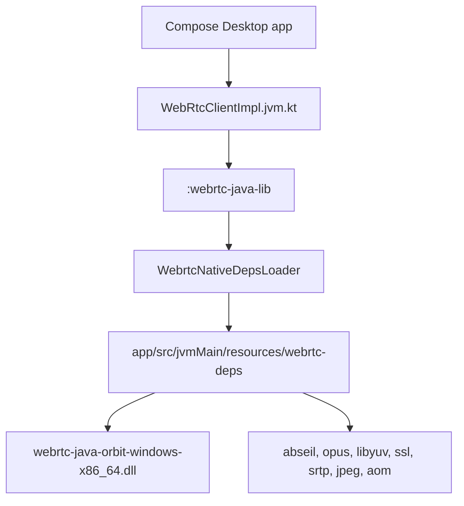

Important desktop files:

| File | Role |
| --- | --- |
| `app/src/jvmMain/kotlin/webrtc/WebRtcClientImpl.jvm.kt` | Desktop peer connection, tracks, devices, screen share |
| `app/src/jvmMain/kotlin/webrtc/WebrtcNativeDepsLoader.kt` | Native dependency loading helper |
| `app/src/jvmMain/kotlin/ui/screen/VideoRenderer.kt` | Desktop Compose video renderer |
| `app/src/jvmMain/kotlin/util/MediaFetch.kt` | Authenticated media fetch (shared by open-externally and voice playback) |
| `app/src/commonMain/kotlin/ui/screen/server/SelfHostingScreen.kt` | "Host your own server" guide, linked from login |
| `app/src/jvmMain/kotlin/ui/screen/CustomTitleBar.kt` | Desktop title bar |
| `app/src/jvmMain/resources/webrtc-deps` | Bundled native WebRTC runtime dependencies |
| `webrtc-java-lib` | Local WebRTC wrapper module |
| `webrtc-java-fork` | Fork/reference source for custom WebRTC behavior |

## Local Storage

```mermaid
flowchart LR
    Credentials["Credentials"] --> AndroidPrefs["Android SharedPreferences"]
    Credentials --> DesktopPrefs["Desktop Java Preferences"]

    Trixnity["Trixnity persistent state"] --> RoomDB["Room KMP database"]
    Media["Matrix media cache"] --> Okio["Okio media store"]
```

| Data | Android | Desktop JVM |
| --- | --- | --- |
| Credentials | `SharedPreferences` file `orbit_creds` | Java Preferences node `com/noobdev/orbit/credentials` |
| Trixnity database | App database path `trixnity.db` | User home `.orbit/trixnity.db` |
| Media cache | App files directory `orbit_media` | User home `.orbit/media` |
| SSO callback | `orbit://sso-callback` | Temporary localhost callback server |

> Note: Credentials are currently stored in platform settings. Treat local development
> machines as trusted environments until a stronger secure-storage layer is added.

## UI Architecture

The shared UI is built in Compose. `OrbitApp.kt` is the main app shell and routes between
authentication, adaptive layout, server navigation, channels, chat, calls, verification,
settings, and join/create flows.

```mermaid
flowchart TD
    App["OrbitApp.kt"] --> Auth["LoginScreen / Session restore"]
    App --> Layout["Adaptive layouts"]
    Layout --> Compact["Compact phone layout"]
    Layout --> Medium["Medium tablet layout"]
    Layout --> Expanded["Expanded desktop layout"]

    Expanded --> Rail["ServerRail"]
    Expanded --> Drawer["ChannelDrawer"]
    Expanded --> Chat["ChatScreen"]
    Expanded --> Members["Member list"]

    App --> Calls["CallScreen"]
    App --> Verify["VerificationOverlay"]
    App --> Settings["SettingsScreen"]
    App --> Join["JoinServerScreen"]
```

### Main Screens

| Screen | Purpose |
| --- | --- |
| `OrbitApp.kt` | App shell, repository wiring, auth routing, adaptive layout, call wiring |
| `LoginScreen.kt` | Login, registration, homeserver selection, SSO entry |
| `ServerRail.kt` | Server/space/DM bucket navigation |
| `ChannelDrawer.kt` | Channel list, DM list, profile bar, invite dialog |
| `ChatScreen.kt` | Timeline, message bubbles, attachments, reactions, input, members |
| `CallScreen.kt` | Incoming/active call UI, controls, local/remote video |
| `JoinServerScreen.kt` | Join/create server and channel flows |
| `VerificationOverlay.kt` | Device verification UI |
| `SettingsScreen.kt` | Theme, display, notification, streaming, and account controls |
| `BottomNavBar.kt` | Compact mode bottom navigation |

### Adaptive Layout

```mermaid
flowchart LR
    Width["Window width"] --> Classifier["WindowSizeClass"]
    Classifier --> Compact["Compact"]
    Classifier --> Medium["Medium"]
    Classifier --> Expanded["Expanded"]
    Compact --> BottomNav["Bottom nav + focused panes"]
    Medium --> Split["Two-pane layout"]
    Expanded --> Desktop["Rail + drawer + chat + members"]
```

## Visual Identity

Orbit uses a lavender-first identity with optional theme variants.

| Token | Value | Usage |
| --- | --- | --- |
| Blurple | `#5865F2` | Brand accent (Discord blurple), selected states, primary actions |
| Steel | `#5B8FC7` | Secondary emphasis and ocean theme |
| Sage | `#49AE81` | Success states and forest theme |
| Red Orange | `#F97316` | Sunset theme and warm emphasis |
| Neon Pink | `#EC4899` | Cyberpunk accent and call/media emphasis |

Icon assets currently include:

| Asset | Purpose |
| --- | --- |
| `Create_a_memorable_modern_app_202605260126.jpeg` | README and logo concept art |
| `app/src/jvmMain/resources/logo.jpeg` | Desktop runtime logo resource |
| `app/src/jvmMain/resources/selfie_segmentation.onnx` | Blur/virtual-background segmentation model |
| `app/src/jvmMain/resources/logo.jpeg` | Window and tray icon |
| `Collection.svg` | Source icon collection |
| `ui/icons/OrbitIcons.kt` | Compose ImageVector icon definitions extracted from the collection |

## Build And Run

### Requirements

- JDK 17.
- Android SDK 34 for Android builds.
- Git.
- Gradle wrapper from this repository.
- Network access to Maven repositories.
- A Matrix account or homeserver with SSO configured.

### Desktop

Run the desktop JVM app:

```powershell
.\gradlew.bat :app:run
```

Compile the desktop Kotlin target:

```powershell
.\gradlew.bat :app:compileKotlinJvm
```

### Android

Build the Android debug APK:

```powershell
.\gradlew.bat :app:assembleDebug
```

Install through Android Studio or Gradle/ADB as usual after the APK is produced.

### Clean

```powershell
.\gradlew.bat clean
```

### Local Java Home

The repository should not hardcode `org.gradle.java.home` for every developer. If your
machine needs a local JDK override, keep it local and do not commit it:

```properties
org.gradle.java.home=C:\\Path\\To\\Your\\JDK17
```

## Developer Workflow

Recommended flow:

```mermaid
flowchart TD
    Pull["git pull --rebase --autostash origin main"] --> Build["Run focused Gradle task"]
    Build --> Edit["Make scoped changes"]
    Edit --> Verify["Compile or test"]
    Verify --> Status["Check git status"]
    Status --> Commit["Commit only relevant files"]
    Commit --> PullAgain["Pull/rebase again"]
    PullAgain --> Push["Push"]
```

Useful commands:

```powershell
git status --short --branch
git pull --rebase --autostash origin main
.\gradlew.bat :app:compileKotlinJvm
.\gradlew.bat :app:assembleDebug
git add -- <files>
git commit -m "Meaningful message"
git push origin main
```

## Troubleshooting

### Invalid Gradle Java Home

If Gradle fails with:

```text
Value 'C:\Program Files\...\jdk-17...' given for org.gradle.java.home is invalid
```

Fix or remove the local `org.gradle.java.home` line in `gradle.properties`. The path must
point to a real JDK 17 folder on the current machine.

### Desktop DirectX / Skiko Warning

If the desktop app prints:

```text
[SKIKO] warn: Fallback to next API
Failed to create DirectX12 device
```

Skiko is falling back to another rendering backend. This is usually a graphics-driver or
environment issue and does not always block the app.

### Missing SLF4J Provider

If the app prints:

```text
SLF4J(W): No SLF4J providers were found.
```

That means logging falls back to a no-op provider. It is noisy but usually not fatal.

### Git Push Rejected

If push is rejected because the remote has new commits:

```powershell
git pull --rebase --autostash origin main
git push origin main
```

### WebRTC Native Loading

Desktop WebRTC depends on native runtime files under `app/src/jvmMain/resources`. If a
native DLL fails to load, check:

- The DLL exists in the resources folder.
- The architecture is Windows x86_64 when running on Windows.
- The app is running with JDK 17.
- The native dependency loader is extracting/loading the bundled files.

### Matrix Call Debugging

Helpful logs usually include:

```text
DEBUG: [WebRTC] Matrix ICE discovery returned ...
DEBUG: [WebRTC] ICE config has ...
DEBUG: [WebRTC] Sending m.call.invite ...
DEBUG: [Sync] Native Call Answer received ...
DEBUG: [Sync] Native Call Candidates received ...
```

When debugging Element interoperability, confirm:

- Orbit sends `m.call.invite` with correct SDP and metadata.
- Orbit sends local ICE candidates after signaling is ready.
- Element returns `m.call.answer`.
- Both sides receive candidates.
- The local audio/video tracks are enabled.

## Known Limitations

| Area | Limitation |
| --- | --- |
| Matrix hierarchy | Some hierarchy and pagination paths are still being refined |
| Group calls | Matrix group calls are not fully implemented |
| Call renegotiation | Media-type switching after call start is limited |
| Credentials | Stored in platform settings rather than a hardened secure vault |
| Logout | Clears app credentials but may not wipe all Trixnity database/media cache data |
| Registration | Full Matrix UIAA registration flow is not complete |
| Edit/delete | Some room ID paths need stronger handling |
| Repository cleanup | Reference/fork source trees are large and should be kept intentional |

## Related Documentation

| Document | Description |
| --- | --- |
| [`VIDEO_CALLING.md`](VIDEO_CALLING.md) | Focused Matrix/WebRTC call-stack documentation |
| [`app/src/commonMain/kotlin/repository/README.md`](app/src/commonMain/kotlin/repository/README.md) | Repository, Matrix, and Trixnity implementation notes |
| [`implementation_plan.md`](implementation_plan.md) | Backend integration notes and historical plan |
| [`todo.md`](todo.md) | Project roadmap notes |

## Regards

Regards to [Ahmed Hassan](https://github.com/AhmadHassan1289) and [Haideransari444](https://github.com/Haideransari444).
