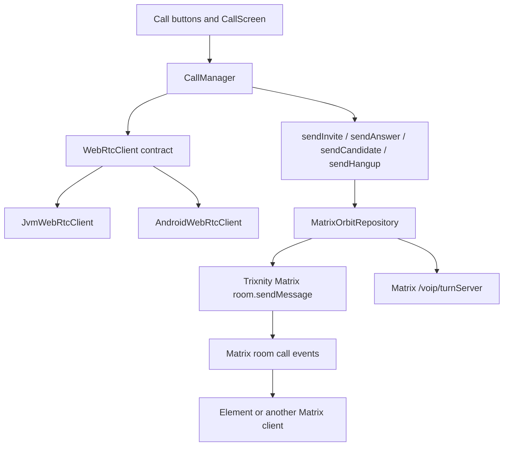
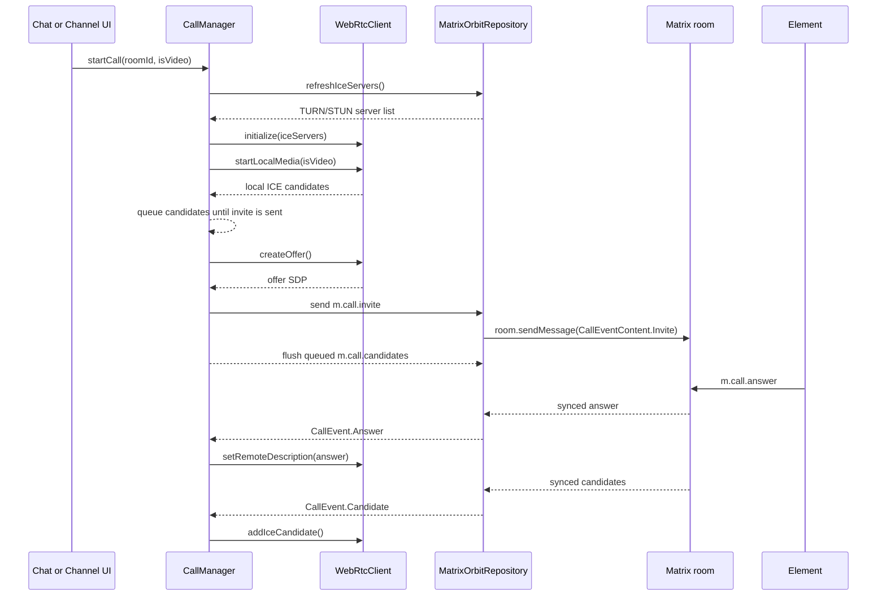
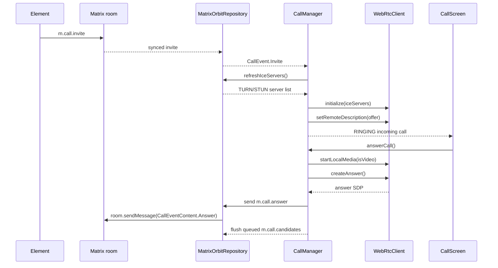

# Video Calling Setup

This document explains the video calling feature currently wired into Orbit. It focuses only on the call stack: Matrix signaling, Trixnity event serialization, WebRTC media setup, Element interoperability, TURN/ICE routing, desktop video rendering, Android support, and the debugging logs used during setup.

## Feature Status

Orbit now has one-to-one Matrix room call support with audio and video paths connected for desktop and Android targets.

Implemented:

- Outgoing audio calls.
- Outgoing video calls.
- Incoming call observation and answering.
- Matrix room call signaling with native Trixnity `CallEventContent` classes.
- WebRTC offer, answer, ICE candidate, and hangup handling.
- TURN server discovery through the Matrix homeserver.
- Desktop camera capture and local preview.
- Desktop remote video rendering through a Compose-friendly frame renderer.
- Android camera, microphone, renderer, and permission plumbing.
- Element interop fixes for call metadata and device identity.
- ICE candidate queuing so local candidates are sent only after invite or answer signaling is ready.
- Camera shutdown when local video is turned off or the call ends.

Not implemented:

- Matrix group calls.
- Jitsi or widget-based calls.
- Screen sharing.
- Call transfer.
- Call hold.
- Full renegotiation for changing call media type after the call starts.
- To-device per-device calling for calling another client logged into the same Matrix user ID.

## Main Files

| File | Role |
| --- | --- |
| `app/src/commonMain/kotlin/webrtc/WebRtcClient.kt` | Shared WebRTC contract used by common UI and call logic. |
| `app/src/commonMain/kotlin/webrtc/CallManager.kt` | Shared call state machine, call start/answer/end logic, ICE server refresh, and candidate queueing. |
| `app/src/commonMain/kotlin/repository/OrbitRepository.kt` | Repository contract for call events and TURN server data. |
| `app/src/commonMain/kotlin/repository/MatrixOrbitRepository.kt` | Matrix/Trixnity implementation of call signaling, TURN discovery, and call event parsing. |
| `app/src/commonMain/kotlin/ui/screen/OrbitApp.kt` | Wires `CallManager` to repository signaling callbacks and batches ICE candidate sends. |
| `app/src/commonMain/kotlin/ui/screen/CallScreen.kt` | Active call UI, incoming controls, local preview, remote video, PiP, mute, camera, and hangup controls. |
| `app/src/commonMain/kotlin/ui/screen/ChatScreen.kt` | Call entry points from chat and active call banner answer action. |
| `app/src/jvmMain/kotlin/webrtc/WebRtcClientImpl.jvm.kt` | Desktop WebRTC implementation using `dev.onvoid.webrtc`. |
| `app/src/jvmMain/kotlin/webrtc/DesktopVideoRenderer.kt` | Converts desktop WebRTC I420 frames into `BufferedImage` frames for Compose rendering. |
| `app/src/jvmMain/kotlin/ui/screen/VideoRenderer.kt` | Desktop actual renderer that displays `DesktopVideoRenderer` output in Compose. |
| `app/src/androidMain/kotlin/webrtc/WebRtcClientImpl.android.kt` | Android WebRTC implementation using `org.webrtc`. |
| `app/src/androidMain/AndroidManifest.xml` | Android camera, microphone, and network permissions. |
| `app/src/androidMain/kotlin/com/noobdev/orbit/MainActivity.kt` | Android runtime permission and app initialization path. |

## High-Level Architecture



The feature is split deliberately:

- UI knows about `CallManager`, not raw Matrix SDK types.
- `CallManager` knows about SDP and ICE models, but it does not directly send Matrix events.
- `MatrixOrbitRepository` knows how to convert Orbit call actions into Matrix call events.
- Platform WebRTC implementations own camera, microphone, peer connection, tracks, and renderers.

## Call State Model

`CallManager` exposes:

| State | Meaning |
| --- | --- |
| `IDLE` | No active call. |
| `RINGING` | Outgoing call is waiting for an answer, or incoming call is waiting for local answer. |
| `CONNECTING` | Offer/answer, media, or ICE setup is in progress. |
| `CONNECTED` | Remote SDP has been applied and the call UI is active. |
| `ENDED` | Call teardown is happening. The manager then returns to `IDLE`. |

It also tracks:

- `activeRoomId`: Matrix room where call signaling is sent.
- `callId`: Matrix call ID for the active call.
- `isIncomingCall`: whether the current call came from a remote invite.
- `isVideoCall`: whether the negotiated call has a video media section.
- `isLocalVideoEnabled`: whether Orbit is currently sending local camera video.
- `isMinimized`: whether the call UI is collapsed into a compact view.

## Outgoing Call Flow



Important behavior:

- Orbit refreshes TURN servers immediately before creating the peer connection.
- Local media starts before creating the offer so the SDP contains audio and, for video calls, video.
- ICE candidates can appear before the Matrix invite is sent. They are queued in `CallManager`.
- Once the invite is sent, queued candidates are flushed to `MatrixOrbitRepository`.
- `OrbitApp.kt` batches ICE candidates for a short period before sending `m.call.candidates`.

## Incoming Call Flow



Incoming video detection is based on the remote offer SDP. If the SDP has an active `m=video` line, Orbit treats the call as a video call and answers with local video enabled when the user accepts.

## Matrix Call Events

Orbit uses Matrix room call events for signaling:

| Event | Sent when | Content source |
| --- | --- | --- |
| `m.call.invite` | Orbit starts a call. | Offer SDP from `createOffer()`. |
| `m.call.answer` | Orbit answers a remote invite. | Answer SDP from `createAnswer()`. |
| `m.call.candidates` | Orbit gathers ICE candidates. | `onIceCandidate` from the platform WebRTC client. |
| `m.call.hangup` | Orbit ends the call. | Current room ID and call ID. |
| `m.call.select_answer` | Orbit receives an answer with `party_id`. | Selected remote party/device ID. |

The call events are sent through Trixnity:

```kotlin
trixnity.room.sendMessage(roomId) {
    content(eventContent)
}
```

That is important because it keeps the send path aligned with Trixnity room behavior, including encrypted room handling where available.

## Trixnity Serialization

`MatrixOrbitRepository.sendCallEvent(...)` maps raw JSON built by the UI layer into Trixnity native classes:

- `CallEventContent.Invite`
- `CallEventContent.Answer`
- `CallEventContent.Candidates`
- `CallEventContent.Hangup`
- `CallEventContent.SelectAnswer`

The repository now uses `version = "1"` for modern Matrix VoIP events. Trixnity serializes the version according to its call event serializer.

### Device Identity With `party_id`

Orbit sets `party_id` to the Matrix device ID:

```kotlin
val myPartyId = CredentialManager.deviceId ?: trixnity.deviceId
```

This lets clients distinguish multiple devices belonging to the same Matrix user. Orbit also filters its own call events by `party_id` in `OrbitApp.kt`, so it does not process its own invite, answer, candidates, or hangup as remote events.

### Invite Target With `invitee`

For direct one-to-one rooms, Orbit tries to identify the single other joined user and writes that Matrix user ID into the invite:

```kotlin
invitee = directInviteeForRoom(roomId)
```

This helps Element decide which user the call invite is for and avoids some ambiguous room-call states.

### SDP Stream Metadata

Element expects modern call events to describe media streams clearly. Orbit now sends `sdp_stream_metadata` on both invites and answers.

The repository extracts stream IDs from SDP lines:

- `a=msid:<streamId> ...`
- `a=ssrc:<id> msid:<streamId> ...`

If no stream ID is found, Orbit falls back to `mediaStream`, which matches the stream ID used when local tracks are added on desktop.

Each stream is serialized as:

```kotlin
StreamMetadata(
    purpose = Purpose.USERMEDIA,
    audioMuted = !hasAudio,
    videoMuted = !hasVideo
)
```

This was added to fix Element timeline and call state behavior where Element could show "The call is in an unknown state!" even though it saw call events in the room.

## Element Interoperability Work

The setup specifically targeted Orbit-to-Element calls. The important interop details are:

- Element expects valid room call events with offer/answer SDP.
- Element relies on `party_id` for modern room call behavior.
- Element can show "unknown state" when call events are visible but not enough metadata exists to build a valid call model.
- Element expects ICE candidates from the remote party. If Orbit does not send local candidates, Element can answer and then hang up when ICE fails.
- Element ignores room call invites that look like they were sent by the same Matrix user in some cases. Calling another client logged into the same Matrix account still needs to-device/per-device call signaling, which Orbit does not implement yet.

The current room-call setup is intended for normal one-to-one calls between different Matrix users, for example Orbit logged in as one account and Element logged in as another account.

## WebRTC Contract

`WebRtcClient` is the shared interface:

```kotlin
interface WebRtcClient {
    val onIceCandidate: SharedFlow<IceCandidateModel>
    val onRemoteDescription: SharedFlow<SessionDescriptionModel>
    val onStreamAdded: SharedFlow<Boolean>

    fun initialize(iceServers: List<TurnServer> = emptyList())
    fun startLocalMedia(isVideoEnabled: Boolean)
    fun createOffer(onSuccess: (SessionDescriptionModel) -> Unit, onError: (String) -> Unit)
    fun createAnswer(onSuccess: (SessionDescriptionModel) -> Unit, onError: (String) -> Unit)
    fun setRemoteDescription(sessionDescription: SessionDescriptionModel)
    fun addIceCandidate(candidate: IceCandidateModel)
    fun endCall()
    fun stopLocalMedia()
    fun toggleMute(isMuted: Boolean)
    fun toggleVideo(isVideoEnabled: Boolean)
    fun switchCamera()
    fun getLocalVideoRenderer(): Any?
    fun getRemoteVideoRenderer(): Any?
}
```

The common code does not depend on Android WebRTC or desktop WebRTC APIs directly. It only calls this interface.

## Desktop WebRTC Setup

Desktop uses:

```text
dev.onvoid.webrtc:webrtc-java:0.14.0
```

`JvmWebRtcClient` does the following:

- Creates a reusable `PeerConnectionFactory`.
- Creates a fresh `RTCPeerConnection` for each call.
- Converts Matrix TURN server data into `RTCIceServer` entries.
- Falls back to `stun:stun.l.google.com:19302` if the homeserver returns no ICE servers.
- Creates an audio track and adds it to the peer connection.
- Selects the first available desktop camera.
- Chooses a camera capability near `640x480@30`.
- Creates a video source and video track when video is enabled.
- Adds local audio/video tracks to stream ID `mediaStream`.
- Attaches remote video tracks from `onAddStream`, `onAddTrack`, and `onTrack`.
- Logs SDP video presence, ICE gathering state, ICE connection state, peer connection state, and candidate types.

### Desktop Video Renderer

Desktop video rendering is handled by `DesktopVideoRenderer`.

The renderer:

- Implements `VideoTrackSink`.
- Receives WebRTC `VideoFrame` objects.
- Converts frames to I420.
- Converts I420 data into a `BufferedImage`.
- Exposes frames through `StateFlow<BufferedImage?>`.
- Throttles rendering to roughly 15 FPS to keep the Compose UI stable.
- Mirrors local preview when requested.
- Avoids double-releasing native buffers.

The double-release fix matters because desktop WebRTC can return the same buffer from `toI420()`. Releasing both the converted buffer and original frame buffer can crash the JVM with a native exit code. The renderer now releases the converted buffer only when it is not the original frame buffer, then releases the frame.

## Android WebRTC Setup

Android uses:

```text
io.getstream:stream-webrtc-android:1.1.2
```

`AndroidWebRtcClient` does the following:

- Initializes `EglBase`.
- Initializes `PeerConnectionFactory`.
- Uses hardware encoder and decoder factories.
- Creates `SurfaceViewRenderer` instances for local and remote video.
- Adds Matrix TURN servers to `PeerConnection.RTCConfiguration`.
- Falls back to public STUN when no homeserver ICE server is available.
- Creates local audio track.
- Creates camera video source and front camera capturer.
- Starts capture at `1280x720@30`.
- Adds local tracks to the peer connection.
- Attaches remote video tracks from stream and track callbacks.
- Stops camera capture when video is disabled or media is stopped.

Android permissions involved:

- `CAMERA`
- `RECORD_AUDIO`
- `INTERNET`
- network state permissions used by the app runtime

`MainActivity` is responsible for initializing the app context and requesting runtime permissions.

## TURN And ICE Setup

Orbit fetches ICE servers from the Matrix endpoint:

```text
GET /_matrix/client/v3/voip/turnServer
```

The response is converted into:

```kotlin
data class TurnServer(
    val uris: List<String>,
    val username: String? = null,
    val password: String? = null
)
```

The call manager refreshes ICE servers before each call setup. This avoids using stale TURN credentials and ensures the peer connection is created with the latest relay configuration.

Expected log:

```text
DEBUG: [WebRTC] Matrix ICE discovery returned 3 urls: turn:..., turn:..., turns:...
DEBUG: [WebRTC] ICE config has 3 server entries
DEBUG: [WebRTC] ICE servers configured: 3 urls: turn:..., turn:..., turns:...
```

If this returns `0 urls`, WebRTC may still work on the same network with host or server-reflexive candidates, but calls across NAT/firewalls are much more likely to fail.

## ICE Candidate Queueing And Batching

ICE candidates can be discovered before the Matrix invite or answer event has reached the room. Sending candidates too early can make the remote side see candidates before it has a call object to attach them to.

Orbit now handles this in two stages:

1. `CallManager` queues local candidates until the invite or answer send completes.
2. `OrbitApp.kt` batches candidates for a short delay and sends them as `m.call.candidates`.

Expected logs:

```text
DEBUG: [WebRTC] Local ICE candidate: host mid=0
DEBUG: [WebRTC] Queued local ICE candidate until signaling is ready
DEBUG: [WebRTC] Flushing 6 queued local ICE candidates
DEBUG: [WebRTC] Sending 6 local ICE candidates
```

The `Sending ... local ICE candidates` line is important. If `Flushing ...` appears without `Sending ...`, the remote client may never receive Orbit candidates and the call will usually fail with:

```text
DEBUG: [WebRTC] ICE connection state: FAILED
DEBUG: [WebRTC] Peer connection state: FAILED
```

This was fixed by launching the batching job on the long-lived Compose coroutine scope rather than the completed `LaunchedEffect` coroutine.

## Video UI Behavior

`CallScreen.kt` renders the active call state:

- Incoming ringing call controls.
- Outgoing ringing state.
- Connecting state.
- Connected call controls.
- Mute toggle.
- Camera toggle.
- Hangup button.
- Minimize button.
- Local video preview while dialing.
- Remote video as the main connected view.
- Local video as picture-in-picture when connected.

Video renderer selection:

| Call phase | Main renderer |
| --- | --- |
| Outgoing video ringing | Local renderer, so the caller sees camera preview. |
| Connected video call | Remote renderer as the main surface. |
| Connected with local video enabled | Local renderer in PiP. |
| Voice-only call | Audio-focused call controls without video surface. |

## Camera Toggle And Capture Shutdown

Camera toggle behavior is handled through:

```kotlin
CallManager.toggleVideo(isVideoEnabled)
```

Desktop:

- Enabling video starts video capture if necessary.
- Disabling video disables the local track and stops the camera source.
- Ending the call disposes the video sender, sink, track, and source.

Android:

- Enabling video enables the local track and restarts capture if needed.
- Disabling video disables the local track and stops camera capture.
- Ending the call stops capture, disposes capturer, helper, source, and tracks.

This was added because the camera light could stay on after turning the camera off if the capture source was only muted but not stopped.

## Hangup Behavior

When Orbit ends a call locally:

1. `CallManager.endCall()` stops local media.
2. The WebRTC peer connection closes.
3. Orbit sends `m.call.hangup`.
4. Call state returns to `IDLE`.

When Orbit receives a remote hangup:

1. The repository emits `CallEvent.Hangup`.
2. `OrbitApp.kt` checks the active call ID.
3. `CallManager.endCall(notifyRemote = false)` tears down local media and peer connection.
4. Orbit does not send another hangup back.

The `notifyRemote = false` path avoids duplicate hangup loops.

## Debug Log Guide

### Healthy Outgoing Video Call

Expected sequence:

```text
DEBUG: [WebRTC] Matrix ICE discovery returned 3 urls: ...
DEBUG: [WebRTC] ICE config has 3 server entries
DEBUG: [WebRTC] ICE servers configured: 3 urls: ...
DEBUG: [WebRTC] Using desktop camera: HP HD Camera
DEBUG: [WebRTC] Desktop video capture started
DEBUG: [WebRTC] Offer SDP has video: true
DEBUG: [WebRTC] ICE gathering state: GATHERING
DEBUG: [WebRTC] Local ICE candidate: host mid=0
DEBUG: [WebRTC] Queued local ICE candidate until signaling is ready
DEBUG: [WebRTC] Flushing 6 queued local ICE candidates
DEBUG: [WebRTC] Sending 6 local ICE candidates
DEBUG: [Sync] Native Call Answer received for call_...
DEBUG: [WebRTC] Remote answer SDP has video: true
DEBUG: [Sync] Native Call Candidates received for call_... (6)
DEBUG: [WebRTC] Adding remote ICE candidate: relay mid=0
DEBUG: [WebRTC] ICE connection state: CONNECTED
```

`CONNECTED` is the important final ICE state.

### Element Shows "Unknown State"

Likely causes:

- Missing `party_id`.
- Missing `sdp_stream_metadata`.
- Invite not targeted well in a one-to-one room.
- Same Matrix user ID is logged into both Orbit and Element.

Orbit now sends `party_id`, `invitee`, and `sdp_stream_metadata`. If the issue still happens while both clients are logged into the same Matrix user account, it is a Matrix room-call limitation and needs to-device signaling.

### Orbit Looks Like Audio-Only During Video Call

Check:

```text
DEBUG: [WebRTC] Offer SDP has video: true
DEBUG: [WebRTC] Remote answer SDP has video: true
```

If offer is `false`, local video track was not added before offer creation. Check camera permission, camera device availability, and `startLocalMedia(isVideo = true)`.

If answer is `false`, the remote client answered without video.

### ICE Fails

Failure looks like:

```text
DEBUG: [WebRTC] ICE connection state: FAILED
DEBUG: [WebRTC] Peer connection state: FAILED
```

Check:

- `Matrix ICE discovery returned X urls` should be greater than `0`.
- Local logs should include `Sending X local ICE candidates`.
- Remote candidates should appear as `Native Call Candidates received`.
- At least one candidate type should be `relay` if NAT/firewall traversal is needed.
- Firewall or VPN software may block UDP/TCP relay connections.

### DirectX12 Warning

This warning can appear on desktop:

```text
org.jetbrains.skiko.RenderException: Failed to create DirectX12 device.
```

Skiko falls back to another rendering API. It is not the WebRTC call failure by itself unless the app fully crashes.

### Native JVM Crash During Video Rendering

A previous desktop crash could happen if video frame buffers were released incorrectly. `DesktopVideoRenderer` now avoids double-release of the I420 buffer.

Relevant behavior:

- Convert to I420.
- Render frame.
- Release converted buffer only if it is not the original frame buffer.
- Release the frame once.

## Build And Run

Compile desktop JVM:

```powershell
.\gradlew.bat compileKotlinJvm
```

Run desktop app:

```powershell
.\gradlew.bat run
```

Build Android debug APK:

```powershell
.\gradlew.bat :app:assembleDebug
```

For local Windows development, JDK 17 is expected:

```powershell
$env:JAVA_HOME='C:\Program Files\Java\jdk-17'
$env:PATH="$env:JAVA_HOME\bin;$env:PATH"
```

## Current Limitations And Next Work

The current implementation is enough for normal one-to-one room calls, but the following items remain future work:

- Add full to-device call signaling for same-user, different-device calls.
- Add proper call renegotiation when enabling video during an audio-only call.
- Send `m.call.sdp_stream_metadata_changed` when mute or video state changes, if needed for stricter clients.
- Add screen sharing with `Purpose.SCREENSHARE`.
- Add richer in-call connection status in the UI.
- Add call duration and call history metadata.
- Add stronger candidate error handling and ICE restart.
- Add tests around Matrix call content construction.
- Add Android runtime verification on physical devices.

## Summary Of What Was Set Up

The video calling setup connects these pieces:

1. UI starts or answers a call through `CallManager`.
2. `CallManager` refreshes Matrix TURN servers.
3. The platform WebRTC client creates local audio/video tracks.
4. WebRTC creates offer or answer SDP.
5. `MatrixOrbitRepository` sends native Trixnity Matrix call events.
6. Orbit includes `party_id`, `invitee`, and `sdp_stream_metadata` for Element compatibility.
7. ICE candidates are queued until signaling is ready, then batched and sent.
8. Remote SDP and remote ICE candidates are applied to the peer connection.
9. Remote video tracks are attached to platform renderers.
10. `CallScreen` displays local preview, remote video, controls, and teardown state.

