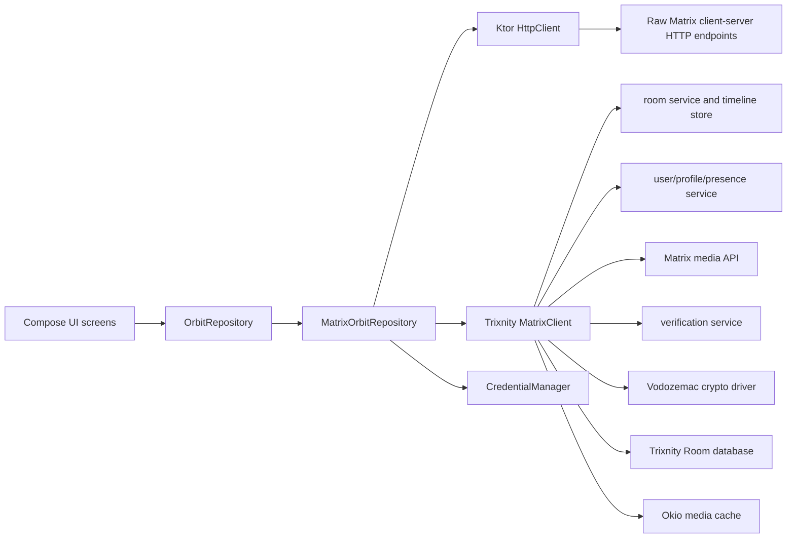
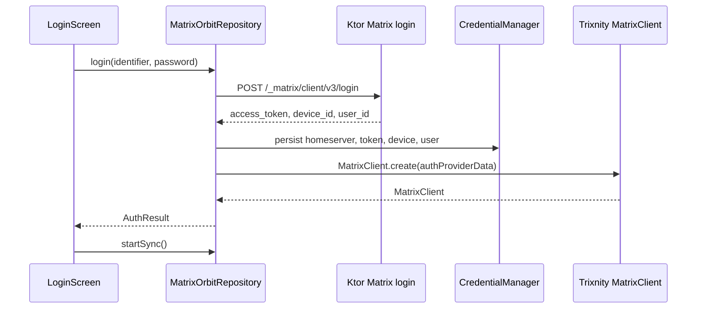
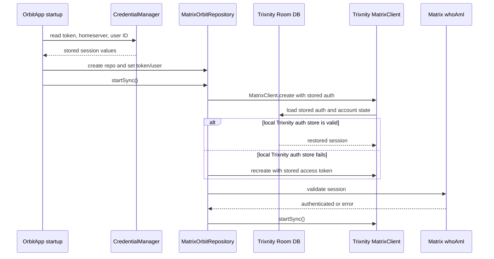
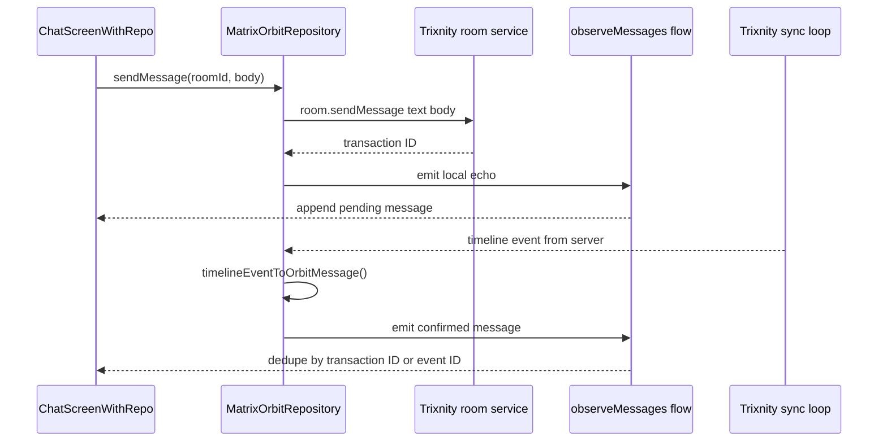

# Orbit Repository Layer

This document explains the repository package in `app/src/commonMain/kotlin/repository`.
It is intentionally detailed because this package is the bridge between the Compose UI and
the Matrix network. It also explains what the project needs in order to run, how the
Trixnity SDK is wired in, and what is currently implemented versus still incomplete.

## Short version

Orbit is a Kotlin Multiplatform Matrix client. The UI uses Discord-like domain models:
`OrbitServer`, `OrbitChannel`, `OrbitMessage`, and `OrbitUser`. The repository layer turns
those app models into Matrix concepts:

- Orbit server = Matrix space, synthetic Direct Messages bucket, or synthetic Rooms bucket.
- Orbit channel = Matrix room.
- Orbit message = Matrix room event.
- Orbit media URL = Matrix `mxc://` URI or a homeserver media download URL.
- Orbit call event = Matrix call signaling event sent into a room.
- Orbit user = Matrix user profile plus presence.

`OrbitRepository` is the public contract used by the UI. `MatrixOrbitRepository` is the
real Matrix-backed implementation.

## Files in this package

| File | Responsibility |
| --- | --- |
| `OrbitRepository.kt` | Public interface for auth, spaces, channels, messages, media, profile, presence, typing, calls, live events, and logout. Also defines `AuthStatus`, `CallEvent`, `AuthResult`, `RegisterResult`, `TurnServer`, and `AuthFlow`. |
| `MatrixOrbitRepository.kt` | Concrete Matrix implementation. Uses Ktor for a few raw Matrix HTTP endpoints and Trixnity for the persistent client, sync, rooms, timeline, media, profile, presence, typing, verification, and crypto-backed Matrix state. |
| `CredentialManager.kt` | Small singleton wrapper around platform settings. Stores homeserver URL, access token, user ID, device ID, and sync token. |
| `Settings.kt` | Kotlin Multiplatform `expect` factory plus a minimal `Settings` interface. Platform implementations live in `androidMain` and `jvmMain`. |
| `DeviceVerificationManager.kt` | Early/stubbed helper for verification state. Current UI mostly uses Trixnity's `activeDeviceVerification` directly instead. |

Related platform files:

| File | Responsibility |
| --- | --- |
| `app/src/androidMain/kotlin/repository/Settings.android.kt` | Stores credentials in Android `SharedPreferences` named `orbit_creds`. Requires `initSettings(context)` to be called from `OrbitApp`. |
| `app/src/jvmMain/kotlin/repository/Settings.jvm.kt` | Stores credentials in Java Preferences node `com/noobdev/orbit/credentials`. |
| `app/src/commonMain/kotlin/util/DatabaseBuilder.kt` | Common `expect` factory for Trixnity's Room database builder. |
| `app/src/androidMain/kotlin/util/DatabaseBuilder.android.kt` | Creates Android Room database at app database path `trixnity.db` with bundled SQLite. |
| `app/src/jvmMain/kotlin/util/DatabaseBuilder.jvm.kt` | Creates desktop Room database at `$HOME/.orbit/trixnity.db` with bundled SQLite. |
| `app/src/commonMain/kotlin/util/MediaStoreProvider.kt` | Common `expect` media cache path provider. |
| `app/src/androidMain/kotlin/util/MediaStoreProvider.android.kt` | Stores Trixnity/Okio media cache under app files directory `orbit_media`. |
| `app/src/jvmMain/kotlin/util/MediaStoreProvider.jvm.kt` | Stores Trixnity/Okio media cache under `$HOME/.orbit/media`. |
| `app/src/commonMain/kotlin/util/Browser.kt` | Common SSO browser hooks. |
| `app/src/androidMain/kotlin/util/Browser.android.kt` | Opens Matrix SSO in Android browser and waits for `orbit://sso-callback`. |
| `app/src/jvmMain/kotlin/util/Browser.jvm.kt` | Opens Matrix SSO in the desktop browser and waits on a temporary localhost callback server. |

## Project prerequisites

Development prerequisites:

- JDK 17. The Android and JVM Kotlin targets are configured with `jvmTarget = "17"`.
- Android SDK with compile SDK 34 for Android builds.
- Gradle wrapper from this repository. The wrapper uses Gradle 8.5.
- Network access to Maven repositories for first build dependency resolution.
- Kotlin Multiplatform and Compose Multiplatform toolchain from Gradle plugins.

Runtime prerequisites:

- A Matrix homeserver URL, for example `https://matrix.org`.
- A Matrix account that can log in with password, or a homeserver that supports Matrix SSO.
- Internet permission on Android. This is present in `AndroidManifest.xml`.
- For SSO on Android, the app must be launched with `android:name=".OrbitApp"` so settings and app context are initialized, and the `orbit://sso-callback` intent filter must remain registered.
- For SSO on JVM, the desktop process must be allowed to open the system browser and listen on a temporary localhost port for the login callback.
- For calls, the homeserver should expose `/_matrix/client/v3/voip/turnServer`; otherwise WebRTC may lack TURN relay configuration.
- For encrypted rooms, the local Trixnity store and crypto driver must remain intact so room keys, sessions, account data, and verification state can be reused.

Main dependency versions from `app/build.gradle.kts`:

| Dependency area | Version or setting |
| --- | --- |
| Kotlin Multiplatform | `2.0.21` |
| Compose Multiplatform plugin | `1.7.3` |
| Android Gradle Plugin | `8.2.2` |
| Android compile SDK | `34` |
| Android min SDK | `24` |
| Ktor client | `3.0.1` |
| Kotlin serialization JSON | `1.7.3` |
| Kotlin datetime | `0.7.1` |
| Room KMP | `2.7.0-alpha11` |
| SQLite bundled driver | `2.5.0-alpha11` |
| Coil Compose | `3.0.0` |
| Trixnity | `5.4.0` |
| Android WebRTC | `io.getstream:stream-webrtc-android:1.1.2` |
| Desktop WebRTC | `dev.onvoid.webrtc:webrtc-java:0.14.0` |

Useful build commands from the repo root:

```powershell
.\gradlew.bat :app:assembleDebug
.\gradlew.bat :app:run
```

## Architecture



The repository layer keeps most Matrix-specific code out of UI components. UI screens call
the `OrbitRepository` interface, then the Matrix implementation converts back and forth:

- Matrix IDs such as `RoomId`, `EventId`, and `UserId` are accepted internally, but UI code mostly sees strings.
- Matrix event content such as `RoomMessageEventContent.TextBased.Text` and `FileBased.Image`
  becomes `MessageContent.Text`, `MessageContent.Image`, etc.
- Matrix rooms and spaces become `OrbitChannel` and `OrbitServer`.
- Matrix flows become UI-friendly Kotlin `Flow` streams.

## Why both Ktor and Trixnity are used

`MatrixOrbitRepository` uses two Matrix access styles:

1. Ktor direct HTTP calls for simple or custom-coded endpoints.
2. Trixnity SDK calls for the long-lived authenticated Matrix client and stateful Matrix features.

Ktor is used for:

- `POST /_matrix/client/v3/login` for password login.
- `POST /_matrix/client/v3/login` with `m.login.token` for SSO login token exchange.
- `POST /_matrix/client/v3/register` for simple registration.
- `GET /_matrix/client/v3/voip/turnServer` for TURN server discovery.
- `POST /_matrix/client/v3/pushers/set` for push pusher registration.

Trixnity is used for:

- Creating and restoring the authenticated `MatrixClient`.
- Persisting Matrix state in a Room database.
- Storing media in an Okio-backed media cache.
- Running the sync loop.
- Tracking rooms, spaces, room state, and timelines.
- Sending text and media messages.
- Reading outbox messages for local echo/pending messages.
- Uploading Matrix media.
- Joining rooms and creating rooms/spaces.
- Reading room members.
- Reading and writing user profile fields.
- Presence and typing notifications.
- Device verification state.
- End-to-end encryption support via the Vodozemac crypto driver.

The important design detail is that the initial login response is currently obtained with
Ktor, then converted into Trixnity `ClassicMatrixClientAuthProviderData`. That auth provider
data lets `MatrixClient.create(...)` initialize or update Trixnity's persisted authentication
store.

## Trixnity modules used by Orbit

Every Trixnity client creation in this repository uses this same module shape:

```kotlin
MatrixClient.create(
    repositoriesModule = RepositoriesModule.room(getRoomDatabaseBuilder()),
    mediaStoreModule = MediaStoreModule.okio(getMediaStorePath()),
    cryptoDriverModule = CryptoDriverModule.vodozemac(),
    authProviderData = authProviderData
)
```

`RepositoriesModule.room(getRoomDatabaseBuilder())`:

- Uses Trixnity's Room-backed repository module.
- Persists account data, authentication data, server data, room list, room state, timelines,
  outbox messages, users, receipts, presence, notification data, key material, verification
  state, and migration metadata.
- Allows `startSync()` to recreate the Matrix client later with `authProviderData = null`,
  as long as the local Trixnity store already contains valid auth and account records.

`MediaStoreModule.okio(getMediaStorePath())`:

- Uses Trixnity's Okio media store.
- Gives Trixnity a local path for downloaded/uploaded media cache files.
- Android path: app files directory plus `orbit_media`.
- JVM path: `$HOME/.orbit/media`.

`CryptoDriverModule.vodozemac()`:

- Enables Trixnity crypto through the Vodozemac driver.
- Supports the crypto primitives Trixnity needs for Matrix E2EE, Olm/Megolm sessions,
  key storage, and verification.

`authProviderData`:

- On fresh login, Orbit passes `ClassicMatrixClientAuthProviderData`.
- On session restore, Orbit first tries `authProviderData = null`, expecting Trixnity to
  load authentication from the Room store.
- If restore fails, Orbit falls back to explicit auth data from `CredentialManager`.

## Public contract: OrbitRepository

`OrbitRepository` is the UI-facing boundary. It has these groups:

Authentication:

- `login(identifier, password, deviceName)`
- `register(username, password)`
- `getCurrentUser()`
- `authStatus`
- `logout()`

Servers and spaces:

- `getSpaces()`
- `joinSpace(roomIdOrAlias)`
- `createSpace(name)`
- `getSpaceHierarchy(spaceId)`

Channels and rooms:

- `getChannelsForSpace(spaceId)`
- `createChannel(spaceId, name, type, topic)`
- `getChannelById(channelId)`
- `getRoomMembers(roomId)`

Messages and media:

- `getMessagesForChannel(channelId, limit, fromToken)`
- `sendMessage(channelId, body)`
- `sendReaction(channelId, eventId, key)`
- `uploadMedia(bytes, mimeType, filename)`
- `sendImageMessage(...)`
- `sendFileMessage(...)`
- `sendAudioMessage(...)`
- `editMessage(eventId, newBody)`
- `deleteMessage(eventId)`
- `sendReadReceipt(roomId, eventId)`

Calls and infrastructure:

- `getTurnServers()`
- `sendCallEvent(channelId, eventType, content)`
- `observeCallEvents()`
- `observeActiveCall(channelId)`
- `observeActiveGroupCall(channelId)`

Profile and presence:

- `updateDisplayName(name)`
- `uploadAvatar(imageBytes)`
- `getUserProfile(userId)`
- `setPresence(status)`
- `observePresence(userId)`
- `setTyping(roomId, isTyping)`
- `observeTyping(roomId)`

Live data:

- `observeMessages(channelId)`
- `observeChannelList(spaceId)`
- `activeDeviceVerification`

Implementation requirements for any repository implementation:

- Keep UI-facing models stable and Matrix-free where possible.
- Return `Result` for operations where UI should handle expected failures.
- Throw only where the existing UI already catches exceptions, such as login and registration.
- Keep long-lived streams as `Flow`.
- Avoid blocking UI threads.
- Maintain local echo for outgoing messages when the backend supports an outbox.
- Preserve the behavior of synthetic server IDs `dm` and `rooms`.

## Session and login lifecycle

### Password login



The password login body uses Matrix login type `m.login.password` with an `m.id.user`
identifier. The username is normalized with `removePrefix("@")`.

After login succeeds:

- `_accessToken` and `_userId` are set in memory.
- `CredentialManager` persists homeserver URL, access token, device ID, and user ID.
- Trixnity is created with `ClassicMatrixClientAuthProviderData`.
- The UI calls `startSync()` after receiving the repository.

### SSO login

SSO starts in `LoginScreen` by calling `repo.loginWithSso()`. The actual browser handling is
platform-specific:

- Android builds a redirect to `orbit://sso-callback`, opens the browser, and waits for
  `SsoHandler` to receive `loginToken` from `MainActivity`.
- JVM opens the browser with a temporary `http://localhost:<port>` redirect and waits up to
  five minutes for the callback.

After a login token is received, `MatrixOrbitRepository` exchanges it by sending
`m.login.token` to the same Matrix login endpoint. The rest of the flow is the same as
password login: credentials are persisted, a Trixnity client is created, and sync starts.

### Session restore

At app startup, `OrbitApp` reads `CredentialManager.accessToken`, `homeserverUrl`, and
`userId`. If all three exist:

1. A new `MatrixOrbitRepository` is created.
2. The token and user ID are copied into the repository with `setAccessToken()` and
   `setUserId()`.
3. `startSync()` is called.
4. `startSync()` tries to create `MatrixClient` with `authProviderData = null`.
5. If the Room store contains Trixnity auth data, Trixnity restores the session.
6. If that fails, Orbit creates explicit `ClassicMatrixClientAuthProviderData` from the
   stored token and homeserver URL.
7. `whoAmI()` validates the session.
8. `authStatus` becomes `Authenticated`, or `Error` if the session is invalid.



### Logout

`logout()`:

- Stops Trixnity sync.
- Clears the `trixnityClient` reference.
- Clears all `CredentialManager` keys.
- Sets `authStatus` to `Unauthenticated`.

It does not currently clear Trixnity's Room database or media cache. That means local Matrix
cache data may remain after logout unless a future change explicitly calls Trixnity cache
cleanup APIs or deletes the platform storage.

## Spaces, rooms, and channels

Matrix has rooms and spaces. Orbit's UI wants a server rail plus channels. The repository
maps Matrix state into that UI shape.

`getSpaces()`:

- Reads a snapshot of all locally known Trixnity rooms.
- Groups direct rooms into a synthetic server:
  - ID: `dm`
  - Name: `Direct Messages`
- Converts Matrix spaces into `OrbitServer` entries:
  - ID: Matrix room ID.
  - Name: explicit Matrix room name or fallback to the last 8 chars of room ID.
  - Icon color: hash of room ID.
  - Avatar: converted from `mxc://` to media download URL.
- Groups normal non-space, non-direct rooms into a synthetic server:
  - ID: `rooms`
  - Name: `Rooms`

`getChannelsForSpace(spaceId)`:

- For `dm`, returns direct Matrix rooms as text channels.
- For `rooms`, returns non-space, non-direct Matrix rooms as text channels.
- For a real Matrix space ID, reads `m.space.child` state events through Trixnity
  `room.getAllState(spaceRoomId, ChildEventContent::class)` and returns children that are
  already present in the local room snapshot.
- Infers `ChannelType.VOICE` when the room name contains `voice`, otherwise uses
  `ChannelType.TEXT`.

`createSpace(name)`:

- Calls Trixnity room create API with `CreateEventContent.RoomType.Space`.
- Returns the new Matrix room ID.

`joinSpace(roomIdOrAlias)`:

- Calls Matrix join through Trixnity using `RoomId(roomIdOrAlias)`.
- Despite the method name, it can join a normal Matrix room if a room ID is passed.
- Despite the parameter name, aliases are not strongly handled here because the value is
  wrapped as `RoomId`, not a Matrix room alias type.

`createChannel(spaceId, name, type, topic)`:

- Creates a Matrix room.
- Uses `TRUSTED_PRIVATE` preset for both text and voice channels.
- If `spaceId` is a real Matrix space, sends a `ChildEventContent` state event into the
  space so the created room appears as a child.

Current behavior to know:

- `getSpaceHierarchy(spaceId)` is currently a stub and returns an empty list.
- Voice channels are not separate Matrix room types. They are inferred by room name.
- Space child channels only show if the child rooms are already present in Trixnity's local
  room list.

## Message lifecycle

### Loading messages

`getMessagesForChannel(channelId, limit, fromToken)`:

1. Gets the Trixnity room by `RoomId`.
2. Reads the room's `lastEventId`.
3. Calls `trixnity.room.getTimelineEvents(..., direction = BACKWARDS)`.
4. Takes `limit` events.
5. Converts each `TimelineEvent` into an `OrbitMessage`.
6. Reverses the historical messages back into chronological order.
7. Reads Trixnity outbox messages for the room.
8. Converts outbox messages into local Orbit messages.
9. Combines timeline and outbox messages.
10. Deduplicates by `transactionId` when possible, otherwise by event ID.
11. Sorts by timestamp.

`fromToken` is part of the interface but is not currently used by the implementation.

### Sending text

`sendMessage(channelId, body)`:

1. Calls `trixnity.room.sendMessage(RoomId(channelId)) { text(body) }`.
2. Receives a transaction ID from Trixnity.
3. Builds a local `OrbitMessage` immediately.
4. Emits that message through the per-channel live message flow.
5. Returns the transaction ID.

The local echo makes the UI feel responsive before the sync loop has received the server
event. Later, timeline and outbox dedupe uses `transactionId`.



### Sending media

Media sending is split into upload and message send:

1. `uploadMedia(bytes, mimeType, filename)` creates a Matrix `Media` object around a
   `ByteReadChannel`.
2. `trixnity.api.media.upload(media)` uploads it and returns an `mxc://` URI.
3. UI chooses the message method based on MIME type:
   - `sendImageMessage(...)`
   - `sendAudioMessage(...)`
   - `sendFileMessage(...)`
4. The message method sends a Matrix `m.room.message` with the right file-based content type.
5. A local echo is emitted.

Trixnity content classes used:

- `FileBased.Image` with `ImageInfo`.
- `FileBased.Audio` with `AudioInfo`.
- `FileBased.File` with `FileInfo`.

When rendering received media, the repository converts `mxc://server/mediaId` into:

```text
{homeserver}/_matrix/media/r3/download/{server}/{mediaId}
```

### Reactions, edits, deletes, and receipts

`sendReaction(channelId, eventId, key)`:

- Sends a `ReactionEventContent` with `RelatesTo.Annotation(EventId(eventId), key)`.

`editMessage(eventId, newBody)`:

- Sends a new text message with `RelatesTo.Replace(EventId(eventId))`.

`deleteMessage(eventId)`:

- Calls Matrix redaction through `trixnity.api.room.redactEvent(...)`.

`sendReadReceipt(roomId, eventId)`:

- Calls `setReadMarkers` with the event as fully read and read marker.

Current behavior to know:

- `editMessage` and `deleteMessage` derive the room ID from the event ID with
  `extractRoomFromEventId`. Matrix event IDs do not reliably encode room IDs, so these
  methods are fragile unless event IDs happen to contain enough room-like data.
- Redacted messages are declared in the UI model but are not currently converted in
  `timelineEventToOrbitMessage`.

## Message parsing

`timelineEventToOrbitMessage(timelineEvent)` is the main conversion point from Trixnity to
Orbit models.

It handles:

- Successful `RoomMessageEventContent`.
- Text messages.
- Image messages.
- Audio messages.
- File messages.
- Video messages.
- Replacements/edits through `RelatesTo.Replace`.
- Replies through `RelatesTo.Reply`.
- Reactions through `ReactionEventContent`.
- Decryption failures by returning a placeholder text message saying the app is waiting
  for keys.

`parseTrixnityMessageContent(content)` maps Trixnity message content to UI `MessageContent`:

| Trixnity content | Orbit content |
| --- | --- |
| `TextBased.Text` | `MessageContent.Text` |
| `FileBased.Image` | `MessageContent.Image` |
| `FileBased.Audio` | `MessageContent.Audio` |
| `FileBased.File` | `MessageContent.File` |
| `FileBased.Video` | `MessageContent.Video` |
| Anything else | `MessageContent.Unsupported` |

Unsupported content still carries a fallback body when available.

## Live sync and flows

`startSync()` is the long-lived sync entry point.

It does this:

1. Restores or creates `trixnityClient`.
2. Calls `whoAmI()` to validate the session.
3. Launches a collector on `trixnity.room.getAll()` and emits updated spaces.
4. Launches a collector on `trixnity.room.getTimelineEventsFromNowOn(...)`.
5. Converts new timeline events to `OrbitMessage`.
6. Emits those messages through the channel's `MutableSharedFlow`.
7. Starts Trixnity's sync loop with `trixnity.startSync()`.

`observeMessages(channelId)`:

- Returns a shared flow for the requested room.
- The repository emits lists of newly received messages, not the full message history.
- UI code appends incoming messages to its current local list and deduplicates.

`observeChannelList(spaceId)`:

- Reacts to `_roomListFlow`.
- Recomputes `getChannelsForSpace(spaceId)` each time the room list changes.

`observeSpaces()`:

- Non-interface helper on `MatrixOrbitRepository`.
- Used by `OrbitApp` to refresh the server rail.

`stopSync()`:

- Clears live message state.
- Stops Trixnity sync asynchronously.

Current behavior to know:

- `_callEvents` exists, and `observeCallEvents()` exposes it, but `startSync()` currently
  does not parse timeline call events into `_callEvents`. `observeActiveCall()` separately
  scans recent timeline events for an active invite.
- `GlobalScope` is used in `observeActiveCall()` and `stopSync()`. Future cleanup should
  prefer the repository scope so jobs are tied to repository lifecycle.

## Calls and WebRTC signaling

Orbit uses Matrix room events as WebRTC signaling transport.

`getTurnServers()`:

- Calls `/_matrix/client/v3/voip/turnServer` with bearer token.
- Converts the response into `TurnServer` values for the WebRTC call manager.

`sendCallEvent(channelId, eventType, content)`:

- Accepts an event type such as:
  - `m.call.invite`
  - `m.call.answer`
  - `m.call.candidates`
  - `m.call.hangup`
- Wraps the provided JSON as Trixnity `UnknownEventContent`.
- Sends it as a Matrix message event into the room.

`observeActiveCall(channelId)`:

- Looks backwards from the room's last event.
- Scans up to 50 timeline events.
- Tracks hangups by call ID.
- Returns the latest invite that has not been followed by a hangup.

Current behavior to know:

- Group call observation is not implemented and returns `flowOf(null)`.
- Live call event emission through `_callEvents` is not wired into the sync collector yet.
- Signaling content is sent as unknown event content, not strongly typed Trixnity call content.

## Profile, presence, and typing

Profile:

- `getUserProfile(userId)` calls `trixnity.api.user.getProfile(UserId(userId))`.
- `updateDisplayName(name)` calls `trixnity.setProfileField(ProfileField.DisplayName(name))`.
- `uploadAvatar(imageBytes)` uploads PNG media, then writes
  `ProfileField.AvatarUrl(mxcUrl.toString())`.

Presence:

- `setPresence(status)` maps:
  - `ONLINE` to Matrix `ONLINE`
  - `IDLE` to Matrix `UNAVAILABLE`
  - `DO_NOT_DISTURB` to Matrix `UNAVAILABLE`
  - `OFFLINE` to Matrix `OFFLINE`
- `observePresence(userId)` observes Trixnity user presence and maps it back into
  `UserStatus`.

Typing:

- `setTyping(roomId, isTyping)` sends Matrix typing state for 30 seconds.
- `observeTyping(roomId)` reads Trixnity `room.usersTyping`.
- The typing content is converted through Trixnity JSON serialization, then the `user_ids`
  array is extracted.

## Credential and local storage

`CredentialManager` stores:

- `homeserverUrl`
- `accessToken`
- `userId`
- `deviceId`
- `syncToken`

The values are stored through the platform `Settings` implementation:

- Android: `SharedPreferences` file `orbit_creds`.
- JVM: Java Preferences node `com/noobdev/orbit/credentials`.

Important security note:

- These credentials are not encrypted by `CredentialManager`.
- Trixnity separately persists its own auth, account, room, timeline, and crypto data in
  the Room-backed store.
- If stronger local security is needed, replace the Android settings implementation with
  encrypted storage and review JVM storage as well.

## Device verification

There are two verification-related paths:

1. `MatrixOrbitRepository.activeDeviceVerification`
2. `DeviceVerificationManager`

The active path is `MatrixOrbitRepository.activeDeviceVerification`, which exposes:

```kotlin
trixnityClient?.verification?.activeDeviceVerification
```

The UI consumes that Trixnity state in `VerificationOverlay`, which:

- Shows incoming verification requests.
- Allows accept/decline.
- Starts SAS verification.
- Displays emoji comparison.
- Calls match/no-match on the Trixnity SAS state.
- Shows completion/cancel states.

`DeviceVerificationManager` currently looks like a planned abstraction:

- It has local states such as `IDLE`, `REQUESTED`, `SHOW_EMOJIS`, `VERIFIED`, and `ERROR`.
- Its methods contain TODOs for binding to Trixnity verification APIs.
- It is not the primary verification path used by the current UI.

## Matrix endpoints and SDK calls by feature

| Feature | Implementation |
| --- | --- |
| Password login | Ktor `POST /_matrix/client/v3/login` with `m.login.password` |
| SSO token exchange | Ktor `POST /_matrix/client/v3/login` with `m.login.token` |
| Register | Ktor `POST /_matrix/client/v3/register` |
| TURN discovery | Ktor `GET /_matrix/client/v3/voip/turnServer` |
| Push pusher | Ktor `POST /_matrix/client/v3/pushers/set` |
| Session validation | Trixnity `api.authentication.whoAmI()` |
| Join room | Trixnity `api.room.joinRoom(...)` |
| Create room | Trixnity `api.room.createRoom(...)` |
| Create space | Trixnity `api.room.createRoom(...)` with space creation content |
| Link room to space | Trixnity `api.room.sendStateEvent(...)` with `ChildEventContent` |
| Room list | Trixnity `room.getAll()` |
| Space children | Trixnity `room.getAllState(..., ChildEventContent::class)` |
| Timeline history | Trixnity `room.getTimelineEvents(...)` |
| Live timeline | Trixnity `room.getTimelineEventsFromNowOn(...)` |
| Text send | Trixnity `room.sendMessage { text(...) }` |
| Media upload | Trixnity `api.media.upload(...)` |
| Media message send | Trixnity `room.sendMessage { roomMessageBuilder(...) { FileBased.*(...) } }` |
| Reaction | Trixnity `api.room.sendMessageEvent(...)` with `ReactionEventContent` |
| Edit | Trixnity `room.sendMessage(...)` with `RelatesTo.Replace` |
| Delete | Trixnity `api.room.redactEvent(...)` |
| Read receipt | Trixnity `api.room.setReadMarkers(...)` |
| Profile read | Trixnity `api.user.getProfile(...)` |
| Profile write | Trixnity `setProfileField(...)` |
| Presence write | Trixnity `api.user.setPresence(...)` |
| Presence observe | Trixnity `user.getPresence(...)` |
| Typing write | Trixnity `api.room.setTyping(...)` |
| Typing observe | Trixnity `room.usersTyping` |
| Verification | Trixnity `verification.activeDeviceVerification` |

## Data model mapping

### OrbitServer

`OrbitServer` represents either:

- A Matrix space.
- The synthetic Direct Messages bucket.
- The synthetic Rooms bucket.

Fields:

- `id`: Matrix room ID, `dm`, or `rooms`.
- `name`: Matrix explicit room name or fallback.
- `iconColor`: Stable hash-generated color.
- `description`: Mostly empty except synthetic buckets.
- `isDM`: true only for the synthetic DM bucket.
- `avatarUrl`: Matrix avatar converted from `mxc://` to an HTTP media download URL.

### OrbitChannel

`OrbitChannel` represents a Matrix room.

Fields:

- `id`: Matrix room ID.
- `name`: Matrix room explicit name or fallback.
- `type`: `TEXT` or `VOICE`.
- `categoryId`: Synthetic bucket ID or parent space ID.
- `topic`: Passed at creation, but not currently read back from Matrix room state.
- `avatarUrl`: Available on model but not currently filled by repository.

### OrbitMessage

`OrbitMessage` represents a Matrix timeline or outbox event.

Fields:

- `id`: Matrix event ID or local transaction ID for outbox/local echo.
- `userId`: Matrix sender user ID.
- `username`: Currently same as sender ID for timeline messages.
- `body`: Plain text fallback.
- `timestamp`: Matrix origin timestamp or local send time.
- `channelId`: Matrix room ID.
- `content`: Rich `MessageContent`.
- `transactionId`: Matrix transaction ID when available, used for dedupe.

### OrbitUser

`OrbitUser` represents a Matrix user.

Fields:

- `id`: Matrix user ID.
- `username`: Shortened localpart in profile lookup, full ID in room member lookup.
- `displayName`: Matrix profile display name or fallback user ID.
- `avatarColor`: Stable hash-generated color.
- `status`: Presence-mapped `UserStatus`.
- `isBot`: Currently false by default.
- `avatarUrl`: Matrix avatar converted to media download URL.

## Error handling patterns

This package uses a mix of exceptions, `Result`, and fallback values:

- Login throws `IllegalStateException` with Matrix error text on non-200 response.
- Register throws `IllegalStateException("Registration failed")`.
- Most user operations return `Result.failure(e)` on errors.
- Many read operations return empty lists or null when not logged in or when an exception is caught.
- Presence setting catches and ignores errors.
- Sync errors update `authStatus` when an unauthorized session is detected.

When adding new repository methods, prefer:

- `Result<T>` for user-triggered operations that can fail.
- `Flow` for live state.
- Empty/null fallback only for truly optional reads.
- Explicit `authStatus` updates for session-wide auth failures.

## Current gaps and risks

Verified against the source on 2026-09-29. Everything that used to be listed here but
no longer applies was removed rather than left to mislead a reader — see the list of
corrections at the bottom of this section.

Still true, roughly in order of how likely they are to bite:

- **Failed sends destroy the message.** `sendMessage()` returns `Result`, but the
  composer clears its input on the success path only in some call sites, and several
  discard the `Result` entirely. A message that fails to send leaves no retry and no
  error. This is the single most user-visible defect left in the repository layer.
- **Channel topics are never read from room state.** `m.room.topic` is written when
  creating a channel but never parsed on the way in. `OrbitChannel.topic` is only
  populated for DMs (from the last message's preview text) and for channels this app
  created itself. A channel someone else made shows a blank topic.
- **Voice channels are inferred from the room name**, not from Matrix state.
  `MatrixContext.channelTypeFor` returns `VOICE` if the name contains "voice". A room
  named `voice-chat-announcements` is a voice channel; a voice channel named anything
  else is a text channel. There is no `m.call` capability check and no voice-channel
  state event.
- **There is no way to *start* a device verification.** `VerificationOverlay` renders
  whatever Trixnity's `activeDeviceVerification` reports, including accepting an
  incoming request and completing SAS — so reacting to a verification works. Nothing
  in the UI ever calls `verification.requestVerification()`, so the user can verify
  when asked but can never initiate. (The old `DeviceVerificationManager` that looked
  like it filled this role was deleted: nothing constructed it and all three of its
  methods only printed a warning.)
- **`joinSpace(roomIdOrAlias)` wraps the input as `RoomId`**, so a `#alias` fails.
  Matrix aliases need to be resolved or passed through as-is.
- **Registration only handles a single-step response** carrying `access_token`. It
  does not implement the UIAA stages a homeserver can demand: `m.login.dummy`,
  terms, email, captcha, or `m.login.registration_token`.
- **Access tokens live in plain platform settings**, not encrypted storage. Anything
  that can read the user's config directory can read the token.
- **Logout closes the Trixnity client but does not purge on-disk data.** The crypto
  store, room database and downloaded media cache survive a logout, so a shared
  machine keeps the previous account's cached content. There is no
  `deleteRecursively` on the cache path anywhere in the codebase.
- **`registerPusher()` reports failure to nobody.** It now inspects the status and logs
  a warning, but it still returns `Unit`, so a caller cannot tell whether push is
  actually working.
- **Several methods catch every exception and return an empty list or null.** That is
  the right call for an optional read and the wrong call for a required one, because
  the UI cannot distinguish "no data" from "the network is down". Anything the user
  explicitly asked for should surface as `Result.failure`.

### Corrections to this list

These were listed before and are no longer true — they are recorded here so nobody
re-adds them from memory:

- `getSpaceHierarchy()` **is** implemented (a real `/_matrix/client/v1/hierarchy` call).
  It simply has no caller.
- `fromToken` in `getMessagesForChannel()` **is** used, and correctly: it is parsed as
  the cursor `EventId` and the cursor event is dropped from the result. The remaining
  gap is that the UI never supplies a token, so history still stops at 50 messages.
- `observeActiveGroupCall()` **is** implemented and wired to `VoiceChannelScreen` and
  `OrbitApp`.
- `observeCallEvents()` / `_callEvents` no longer exist. The symbol was removed; call
  state is driven by `CallStateResolver` plus the `m.call.member` collector instead.
- `editMessage()` and `deleteMessage()` **take an explicit `roomId`** now. Neither
  infers the room from the event ID any more.
- `sendFileMessage()` / `sendAudioMessage()` **return the transaction ID** and no
  longer stamp a hardcoded timestamp.
- Logout **now stops sync, then closes the Trixnity client**, then tears down our own
  scope and HTTP client, in that order. It previously leaked a supervisor job and a CIO
  selector thread per login cycle and kept 401-storming the server.

## Adding or changing repository behavior

Recommended workflow:

1. Add or update the method in `OrbitRepository`.
2. Implement it in `MatrixOrbitRepository`.
3. Convert Matrix/Trixnity types into Orbit UI models before returning.
4. Decide whether the method should throw, return `Result`, or expose `Flow`.
5. Update local echo and live flow behavior if the method changes visible timeline state.
6. Keep platform-specific storage, browser, or filesystem behavior behind `expect/actual`
   utilities in `util` or `repository`.
7. Update this document if a Matrix endpoint, Trixnity module, storage path, or public
   repository contract changes.

When using Trixnity in new code:

- Use `trixnityClient ?: return Result.failure(IllegalStateException("Not logged in"))`
  for user operations.
- Use `RoomId`, `EventId`, and `UserId` wrappers at API boundaries.
- Prefer Trixnity services (`room`, `user`, `verification`) when state, sync, cache,
  crypto, or typed event models are involved.
- Use direct Ktor only when the SDK route is not available, is awkward for a simple endpoint,
  or the code is intentionally handling raw Matrix JSON.
- Keep local database and media path creation platform-specific.

## Quick operational checklist

Before running the app:

- JDK 17 is installed and selected.
- Android SDK 34 is available for Android builds.
- The repo can resolve dependencies from Google Maven, Maven Central, Gradle Plugin Portal,
  JitPack, and JogAmp Maven.
- Android application class is `com.noobdev.orbit.OrbitApp`.
- Android manifest keeps `INTERNET` permission.
- Matrix homeserver URL is reachable.
- Matrix account credentials or SSO provider are available.
- Desktop SSO can open a browser and bind a temporary localhost port.

After login:

- `CredentialManager` contains homeserver URL, access token, user ID, and device ID.
- Trixnity Room database exists at the platform path.
- Trixnity media cache directory exists at the platform path.
- `startSync()` passes `whoAmI()`.
- `_roomListFlow` begins emitting spaces.
- `getTimelineEventsFromNowOn()` begins feeding live messages.
