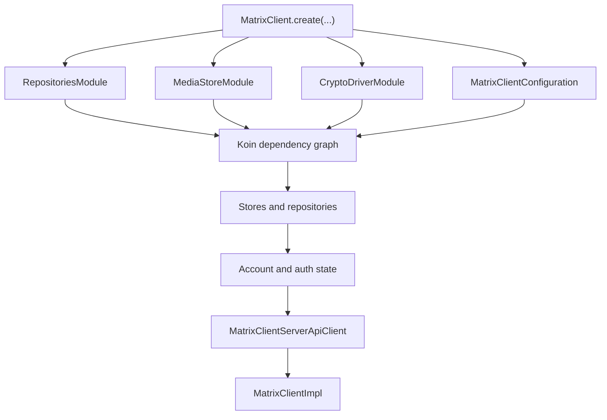
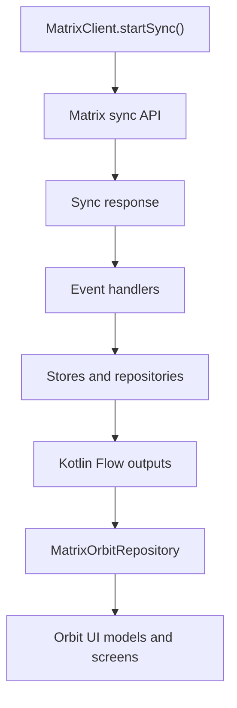
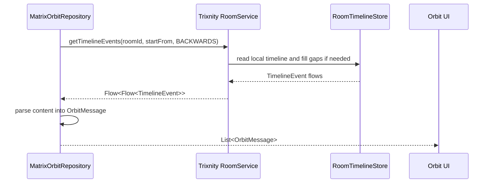
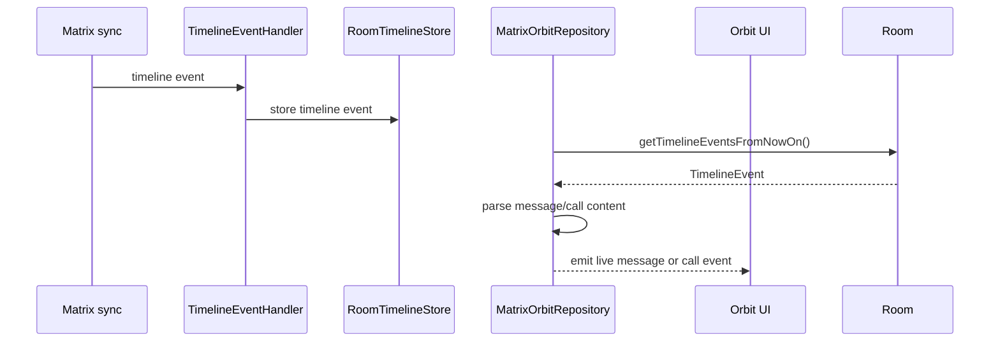

# Trixnity Source Reference

This folder is a local source reference for the Trixnity Matrix client code used by Orbit. It is here so Orbit developers can inspect how Trixnity handles sync, rooms, timelines, media, verification, encryption storage, and client state without jumping into the Gradle cache.

The folder is documentation/reference material for developers. It is not Orbit application code, and it should not be treated as the main place to patch app behavior. Orbit app behavior should normally be changed in `app/src/...`; Trixnity source should be read here to understand SDK behavior and then used through the real dependency APIs.

## Scope

This folder contains the Trixnity client source package under:

```text
trixnity-src/commonMain/de/connect2x/trixnity/client
```

It includes client-side modules such as:

- Matrix client creation and lifecycle.
- Sync state and sync orchestration.
- Room list, timeline, outbox, typing, state, and room encryption services.
- User profile, presence, account data, and power-level helpers.
- Media cache and media upload/download services.
- Verification state machines.
- Key backup, secret sharing, room key requests, and crypto-driver integration.
- Store abstractions and repository/cache interfaces.

It does not contain every source file from every Trixnity module. For example, many Matrix event model classes, Matrix client-server API model classes, and crypto primitives come from other Trixnity artifacts in Gradle. Orbit still imports those from dependencies.

## Why This Folder Exists

Orbit uses Trixnity heavily through `MatrixOrbitRepository`. During development, this source mirror helps answer questions like:

- How does `MatrixClient.create(...)` restore a stored account?
- What happens when `startSync()` is called?
- Which service owns timelines and decryption?
- How does `room.sendMessage(...)` flow into the outbox and Matrix API?
- Where are Matrix rooms, room state, timeline events, account data, and crypto state stored?
- Which Trixnity services are available through convenience properties such as `trixnity.room`, `trixnity.user`, and `trixnity.verification`?
- Why does a Matrix call event parse as native content or as unknown content?
- Which layer should Orbit call directly and which layer should remain hidden behind `OrbitRepository`?

This is especially useful because Orbit mixes two Matrix access styles:

1. Trixnity SDK services for long-lived authenticated client behavior.
2. Direct Ktor HTTP calls for simple endpoints or custom flows.

## Relationship To Orbit

Orbit creates a Trixnity `MatrixClient` in:

```text
app/src/commonMain/kotlin/repository/MatrixOrbitRepository.kt
```

The creation pattern is:

```kotlin
MatrixClient.create(
    repositoriesModule = RepositoriesModule.room(getRoomDatabaseBuilder()),
    mediaStoreModule = MediaStoreModule.okio(getMediaStorePath()),
    cryptoDriverModule = CryptoDriverModule.vodozemac(),
    authProviderData = authProviderData
)
```

Orbit relies on Trixnity for:

| Orbit feature | Trixnity area |
| --- | --- |
| Session restore | `MatrixClient.create`, `AuthenticationStore`, `AccountStore` |
| Sync loop | `MatrixClient.startSync`, `CurrentSyncState`, event handlers |
| Room list | `RoomService`, `RoomStore`, `RoomListHandler` |
| Timeline history | `RoomService.getTimelineEvents`, `RoomTimelineStore` |
| Live timeline | `RoomService.getTimelineEventsFromNowOn`, `TimelineEventHandler` |
| Message sending | `RoomService.sendMessage`, outbox services |
| Encrypted room state | crypto-driver module, key services, room encryption services |
| Media upload/download | `MediaService`, `MediaStore`, media cache mapping store |
| User profile | `UserService`, direct `api.user` calls |
| Presence | `UserService`, `UserPresenceStore` |
| Typing | `RoomService.usersTyping`, typing event handlers |
| Verification | `VerificationService`, active verification models |
| Matrix JSON | default event serializer mappings and `createMatrixEventJson` |

Orbit's UI does not import these Trixnity source classes directly. The UI calls `OrbitRepository`; `MatrixOrbitRepository` converts Trixnity and Matrix types into Orbit domain models.

## Directory Map

```text
trixnity-src
|-- META-INF
|   `-- MANIFEST.MF
`-- commonMain
    `-- de/connect2x/trixnity/client
        |-- MatrixClient.kt
        |-- MatrixClientConfiguration.kt
        |-- defaultModules.kt
        |-- serverDiscovery.kt
        |-- cryptodriver
        |-- key
        |-- media
        |-- notification
        |-- room
        |-- server
        |-- store
        |   |-- cache
        |   `-- repository
        |-- user
        |-- utils
        `-- verification
```

Approximate package size in this mirror:

| Package | Files | Purpose |
| --- | ---: | --- |
| `client` root | 8 | Client entry points, lifecycle, configuration, server discovery, module setup. |
| `cryptodriver` | 6 | Glue between client stores and the configured crypto driver. |
| `key` | 14 | Device keys, room key requests, key backup, secret key sharing. |
| `media` | 8 | Media service, media store abstractions, cache-backed media handling. |
| `notification` | 15 | Push rule and notification calculation/storage support. |
| `room` | 39 | Room service, timeline, room event handlers, outbox, encryption services. |
| `server` | 2 | Server data retrieval and storage integration. |
| `store` | 98 | Store models, observable caches, repository interfaces, repository migrations. |
| `user` | 12 | User profile, presence, account data, power-level helpers, member loading. |
| `utils` | 2 | Retry and flow helpers used by client services. |
| `verification` | 11 | Device/user verification state and SAS verification helpers. |

## Client Root Package

Path:

```text
trixnity-src/commonMain/de/connect2x/trixnity/client
```

Important files:

| File | Purpose |
| --- | --- |
| `MatrixClient.kt` | Main interface, creation function, implementation, lifecycle, sync control, logout, cache clearing, profile update. |
| `MatrixClientConfiguration.kt` | Runtime configuration, module factories, HTTP engine/config, sync filters, timeline storage options. |
| `defaultModules.kt` | Koin module factory list for store, room, user, key, crypto, verification, media, notification, JSON, and server modules. |
| `CurrentSyncState.kt` | Tracks the current Matrix sync state and sync token behavior. |
| `MatrixClientStarted.kt` | Started-state helper used by services. |
| `MatrixClientAuthProviderDataSerializerMappings.kt` | Serialization mapping for auth provider data. |
| `serverDiscovery.kt` | Server discovery helpers. |
| `utils.kt` | Client-level utility helpers. |

### MatrixClient

`MatrixClient` is the main Trixnity client interface. Orbit mostly uses these members:

- `userId`
- `deviceId`
- `baseUrl`
- `api`
- `room`
- `user`
- `verification`
- `startSync()`
- `stopSync()`
- `logout()`
- `setProfileField(...)`

The companion `create(...)` function builds the actual client from three required modules:

- `RepositoriesModule`
- `MediaStoreModule`
- `CryptoDriverModule`

This design is why Orbit can choose platform-specific persistence and media paths while keeping the rest of the repository code common.

### Client Creation Flow



The creation flow does several important things:

- Builds a coroutine scope for the client.
- Creates Koin modules from the supplied repository/media/crypto modules.
- Adds Trixnity default modules from `defaultModules.kt`.
- Runs repository migrations.
- Reads or writes authentication state.
- Validates the account with Matrix `whoAmI()` during first auth or re-auth.
- Creates a `MatrixClientServerApiClient`.
- Creates service instances for rooms, users, media, keys, verification, notifications, and sync handling.

## defaultModules.kt

`defaultModules.kt` defines which services are part of the normal Trixnity client.

Important factory groups:

- `createMatrixClientStartedModule`
- `createClockModule`
- `createServerModule`
- `createDefaultEventContentSerializerMappingsModule`
- `createDefaultOutboxMessageMediaUploaderMappingsModule`
- `createDefaultMatrixJsonModule`
- `createDefaultMatrixClientAuthProviderSerializerMappings`
- `createCurrentSyncStateModule`
- `createStoreModule`
- `createRoomModule`
- `createUserModule`
- `createKeyModule`
- `createCryptoModule`
- `createVerificationModule`
- `createMediaModule`
- `createNotificationModule`

Orbit uses the default client module stack. That means room, user, verification, media, key, and notification services are available from the Trixnity client when the client is created successfully.

## Room Package

Path:

```text
trixnity-src/commonMain/de/connect2x/trixnity/client/room
```

This is the most important package for Orbit messaging.

Key responsibilities:

- Room list updates.
- Room state updates.
- Timeline history.
- Live timeline events.
- Message sending and retry through the outbox.
- Draft messages.
- Typing events.
- Direct room account data.
- Room upgrades.
- Room encryption and decryption service selection.
- Timeline aggregation and relation handling.

Important files:

| File | Purpose |
| --- | --- |
| `RoomService.kt` | Main room API: timeline access, message send, outbox, state, typing, room lookup. |
| `RoomServiceExtensions.kt` | Convenience extension helpers for room operations. |
| `Timeline.kt` | Timeline abstraction for managing loaded timeline windows. |
| `TimelineEventHandler.kt` | Handles sync timeline events and writes them into stores. |
| `TimelineEventAggregation.kt` | Handles timeline relations and aggregations. |
| `RoomListHandler.kt` | Sync handler for joined/invited/left room lists. |
| `RoomStateEventHandler.kt` | Sync handler for room state. |
| `RoomAccountDataEventHandler.kt` | Sync handler for room account data. |
| `TypingEventHandler.kt` | Sync handler for typing events. |
| `DirectRoomEventHandler.kt` | Handles direct room account data. |
| `RoomUpgradeHandler.kt` | Handles room tombstone/upgrade behavior. |
| `OutboxMessageEventHandler.kt` | Sends queued outbox messages. |
| `MegolmRoomEventEncryptionService.kt` | Encrypted room event path. |
| `UnencryptedRoomEventEncryptionService.kt` | Plain room event path. |

### RoomService Methods Orbit Uses

Orbit uses `RoomService` through `trixnity.room`.

Important calls in Orbit:

| Orbit use | Trixnity call |
| --- | --- |
| Get all rooms | `trixnity.room.getAll()` |
| Get room by ID | `trixnity.room.getById(RoomId(...))` |
| Read historical timeline | `trixnity.room.getTimelineEvents(...)` |
| Read live timeline | `trixnity.room.getTimelineEventsFromNowOn(...)` |
| Send text/media/call message | `trixnity.room.sendMessage(roomId) { ... }` |
| Read typing state | `trixnity.room.usersTyping` |
| Read state events | `trixnity.room.getAllState(...)` |

The room service usually returns Kotlin `Flow` values. Orbit often calls `first()` when it needs a snapshot, and `collectLatest` when it needs live updates.

## Room Outbox Package

Path:

```text
trixnity-src/commonMain/de/connect2x/trixnity/client/room/outbox
```

This package handles messages that need media upload or asynchronous send behavior before they become final Matrix events.

Important concepts:

- Outbox messages are stored before being sent.
- Media can be uploaded before the final event is sent.
- Different event content types can have different media upload mappings.
- Trixnity can retry or cancel pending sends.

Orbit benefits from this when sending messages via:

```kotlin
trixnity.room.sendMessage(RoomId(channelId)) {
    roomMessageBuilder { ... }
}
```

For custom call events, Orbit sends native call event content through `room.sendMessage` as well. Call events do not use media upload, but they still go through Trixnity's room sending path.

## Store Package

Path:

```text
trixnity-src/commonMain/de/connect2x/trixnity/client/store
```

This is the largest package in the folder. It defines the local data model and store interfaces that Trixnity uses to cache Matrix client state.

Important store types:

| Store/model | Purpose |
| --- | --- |
| `AccountStore` | Stored Matrix user/device/account metadata. |
| `AuthenticationStore` | Stored auth provider data and authentication state. |
| `RoomStore` | Local room records. |
| `RoomStateStore` | Current room state event records. |
| `RoomTimelineStore` | Timeline event records. |
| `RoomOutboxMessageStore` | Pending outbox messages. |
| `RoomAccountDataStore` | Per-room account data. |
| `GlobalAccountDataStore` | Global account data. |
| `RoomUserStore` | Room member/user data. |
| `UserPresenceStore` | Presence cache. |
| `MediaCacheMappingStore` | Media cache mapping metadata. |
| `NotificationStore` | Notification records. |
| `OlmCryptoStore` | Crypto state for E2EE. |
| `KeyStore` | Device/cross-signing/key state. |
| `TimelineEvent` | Trixnity timeline event wrapper used by Orbit message parsing. |

Orbit does not usually access these store classes directly. It configures them with:

```kotlin
RepositoriesModule.room(getRoomDatabaseBuilder())
```

That gives Trixnity a Room-backed persistence implementation. Orbit then reads through high-level services such as `trixnity.room` and `trixnity.user`.

## Store Repository Package

Path:

```text
trixnity-src/commonMain/de/connect2x/trixnity/client/store/repository
```

This package defines repository contracts and base implementations behind the stores.

Important ideas:

- `FullRepository`
- `MinimalRepository`
- `MapRepository`
- `DeleteByRoomIdRepository`
- `RepositoryTransactionManager`
- `RepositoryMigration`
- many concrete repository interfaces for account, room, state, timeline, crypto, notification, and media mapping data

Trixnity supports multiple repository backends. Orbit uses the Room repository module, so the interfaces in this package are backed by generated Room database classes from the Trixnity dependency.

## Store Cache Package

Path:

```text
trixnity-src/commonMain/de/connect2x/trixnity/client/store/cache
```

This package provides observable cache wrappers around repositories.

Why it matters:

- Trixnity services expose flows.
- Stores can emit changes when sync or API actions update data.
- Orbit UI can collect high-level flows without manually polling Matrix endpoints.

## User Package

Path:

```text
trixnity-src/commonMain/de/connect2x/trixnity/client/user
```

Responsibilities:

- Profile access.
- Presence access.
- Account data handling.
- Room member loading.
- Power-level checks.
- Permission helpers.

Important files:

| File | Purpose |
| --- | --- |
| `UserService.kt` | Main user/profile/presence service API. |
| `LoadMembersService.kt` | Loads room members when needed. |
| `GlobalAccountDataEventHandler.kt` | Sync handler for global account data. |
| `GetPowerLevel.kt` | Reads effective room power levels. |
| `CanDoAction.kt` | Permission helper for actions in rooms. |
| `UserInfo.kt` | Current user/device info wiring. |

Orbit uses this area for:

- Presence observation.
- Profile data.
- Typing/member-related behavior through room/user stores.

Orbit also still uses direct Matrix API calls for some simple profile operations, such as `api.user.getProfile(...)`.

## Media Package

Path:

```text
trixnity-src/commonMain/de/connect2x/trixnity/client/media
```

Responsibilities:

- Uploading media.
- Downloading media.
- Validating media.
- Managing media cache.
- Mapping `mxc://` Matrix content URIs to local cached files.

Important files:

| File | Purpose |
| --- | --- |
| `MediaService.kt` | Main media service. |
| `MediaStore.kt` | Media storage abstraction. |
| `CachedMediaStore.kt` | Cache-backed media store behavior. |
| `InMemoryMediaStore.kt` | In-memory media store implementation. |
| `createMediaModule.kt` | Koin module creation for media service/store wiring. |
| `MediaValidationException.kt` | Media validation failure type. |
| `MediaTooLargeException.kt` | Media size failure type. |

Orbit configures media storage with:

```kotlin
MediaStoreModule.okio(getMediaStorePath())
```

Platform paths are defined in Orbit's `util/MediaStoreProvider.*.kt`.

## Crypto Driver Package

Path:

```text
trixnity-src/commonMain/de/connect2x/trixnity/client/cryptodriver
```

Responsibilities:

- Connect Trixnity client stores to the configured crypto driver.
- Handle Olm/Megolm encryption service requests.
- Persist and expose crypto account/session state.
- Emit key changes.

Important files:

| File | Purpose |
| --- | --- |
| `createCryptoModule.kt` | Koin module for crypto-driver integration. |
| `ClientOlmStore.kt` | Client-side Olm store adapter. |
| `ClientSignServiceStore.kt` | Store adapter for signing service state. |
| `ClientOlmEncryptionServiceRequestHandler.kt` | Handles encryption service requests. |
| `ClientOlmEventHandlerRequestHandler.kt` | Handles crypto event handler requests. |
| `ClientOlmKeysChangeEmitter.kt` | Emits key changes to relevant services. |

Orbit configures crypto with:

```kotlin
CryptoDriverModule.vodozemac()
```

That means Trixnity uses the Vodozemac crypto driver for Matrix E2EE primitives.

## Key Package

Path:

```text
trixnity-src/commonMain/de/connect2x/trixnity/client/key
```

Responsibilities:

- Device key management.
- Key backup.
- Dehydrated device support.
- Incoming and outgoing room key requests.
- Incoming and outgoing secret key requests.
- Key trust and key secret services.

Important files:

| File | Purpose |
| --- | --- |
| `KeyService.kt` | Main key service. |
| `KeyBackupService.kt` | Key backup integration. |
| `KeyTrustService.kt` | Trust/cross-signing related checks. |
| `KeySecretService.kt` | Secret sharing. |
| `DehydratedDeviceService.kt` | Dehydrated device behavior. |
| `IncomingRoomKeyRequestEventHandler.kt` | Handles incoming room key requests. |
| `OutgoingRoomKeyRequestEventHandler.kt` | Sends room key requests. |
| `IncomingSecretKeyRequestEventHandler.kt` | Handles incoming secret key requests. |
| `OutgoingSecretKeyRequestEventHandler.kt` | Sends secret key requests. |

Orbit does not currently expose all of these as UI features, but they matter for encrypted rooms and verification correctness.

## Verification Package

Path:

```text
trixnity-src/commonMain/de/connect2x/trixnity/client/verification
```

Responsibilities:

- Device verification.
- User verification.
- SAS verification state.
- Active verification state tracking.
- Verification method abstractions.

Important files:

| File | Purpose |
| --- | --- |
| `VerificationService.kt` | Main verification service. |
| `ActiveDeviceVerification.kt` | Active device verification model consumed by Orbit UI. |
| `ActiveUserVerification.kt` | Active user verification model. |
| `ActiveVerification.kt` | Shared active verification base. |
| `ActiveVerificationState.kt` | General verification state. |
| `ActiveSasVerificationState.kt` | SAS-specific verification state. |
| `ActiveSasVerificationMethod.kt` | SAS verification method behavior. |
| `SelfVerificationMethod.kt` | Self-verification method definitions. |
| `createVerificationModule.kt` | Koin module for verification wiring. |

Orbit consumes:

```kotlin
trixnityClient?.verification?.activeDeviceVerification
```

The UI then renders the verification flow in `VerificationOverlay`.

## Notification Package

Path:

```text
trixnity-src/commonMain/de/connect2x/trixnity/client/notification
```

Responsibilities:

- Notification state.
- Push rule evaluation.
- Notification event handling.
- Notification storage and updates.

Orbit has notification-related UI/settings, but this package is mostly a reference for future deeper notification integration.

## Server Package

Path:

```text
trixnity-src/commonMain/de/connect2x/trixnity/client/server
```

Responsibilities:

- Server data service.
- Server data module creation.

This supports state such as homeserver capabilities and server data used by the client.

## Utils Package

Path:

```text
trixnity-src/commonMain/de/connect2x/trixnity/client/utils
```

Responsibilities:

- Retry helpers.
- Flow helpers for sync-aware retry behavior.

These utilities are used internally by services that need to tolerate offline or sync-changing behavior.

## Sync Pipeline

Trixnity's sync pipeline starts with `MatrixClient.startSync()`.

At a high level:



The handlers registered in `defaultModules.kt` update local stores. Orbit then reads from Trixnity services and stores indirectly through flows.

Important sync-driven Orbit behavior:

- Room list updates through `room.getAll()`.
- Timeline updates through `room.getTimelineEventsFromNowOn(...)`.
- Call events are parsed from live timeline events.
- Typing state comes from `room.usersTyping`.
- Verification state is exposed through `verification.activeDeviceVerification`.

## Timeline And Message Flow

Orbit uses two timeline paths:

1. Historical timeline loading for chat history.
2. Live timeline collection during sync.

Historical path:



Live path:



## Sending Messages

Orbit sends normal messages through `RoomService.sendMessage`.

Example shape:

```kotlin
trixnity.room.sendMessage(RoomId(channelId)) {
    roomMessageBuilder {
        text("hello")
    }
}
```

Internally, Trixnity can use the outbox, media upload mappings, encryption services, and Matrix API client to send the final event.

For custom call events, Orbit builds a native Trixnity event content object and sends it through the same room send API:

```kotlin
trixnity.room.sendMessage(roomId) {
    content(CallEventContent.Invite(...))
}
```

This is why the Trixnity room package matters for video calling too.

## Event Content And Unknown Events

Trixnity uses event serializer mappings to decode Matrix event content into typed Kotlin classes.

When an event type is known, Orbit can receive native content such as:

- `RoomMessageEventContent.TextBased.Text`
- `RoomMessageEventContent.FileBased.Image`
- `CallEventContent.Invite`
- `CallEventContent.Answer`
- `CallEventContent.Candidates`
- `CallEventContent.Hangup`

When an event type is not mapped, Trixnity can expose it as unknown content. Orbit handles this in `MatrixOrbitRepository` by reading the raw JSON and manually extracting fields for call events when needed.

This matters for Matrix calls because some servers or clients may send event shapes that do not decode exactly as native classes.

## Video Calling Relevance

The Trixnity client source folder is not the WebRTC implementation. WebRTC lives in Orbit's `app/src/.../webrtc` files.

Trixnity's role in video calling is signaling:

- Send `m.call.invite`.
- Send `m.call.answer`.
- Send `m.call.candidates`.
- Send `m.call.hangup`.
- Sync remote call events from the Matrix room.
- Preserve encrypted room behavior through Trixnity's room send path where possible.
- Serialize call event content using Matrix event mappings.

The WebRTC peer connection, camera, microphone, renderers, and ICE candidate generation are handled by Orbit's platform WebRTC clients.

## How To Use This Folder During Debugging

Use this folder to answer SDK behavior questions. Good examples:

- Search `RoomService.kt` when message send or timeline read behavior is confusing.
- Search `TimelineEventHandler.kt` when a Matrix event appears in sync but not in the local timeline.
- Search `defaultModules.kt` when a service is missing or not injected.
- Search `MatrixClient.kt` when login restore, sync lifecycle, or logout behavior is confusing.
- Search `store/repository` when local Room persistence behavior is unclear.
- Search `verification` when SAS/device verification UI state is confusing.
- Search `media` when uploads, downloads, cache mappings, or media paths are confusing.
- Search `cryptodriver` and `key` when encrypted rooms or key requests behave unexpectedly.

Useful commands:

```powershell
rg -n "MatrixClient.create|startSync|stopSync" trixnity-src
rg -n "sendMessage|getTimelineEvents|getTimelineEventsFromNowOn" trixnity-src/commonMain/de/connect2x/trixnity/client/room
rg -n "UnknownEventContent|EventContentSerializerMappings" trixnity-src
rg -n "activeDeviceVerification|ActiveSas" trixnity-src/commonMain/de/connect2x/trixnity/client/verification
rg -n "MediaService|MediaStore|CachedMediaStore" trixnity-src/commonMain/de/connect2x/trixnity/client/media
```

## How Not To Use This Folder

Do not make Orbit feature fixes directly inside `trixnity-src` unless the project intentionally vendors and compiles this source. This folder is a tracked source reference. The compiled Trixnity code still comes from Gradle dependencies.

For Orbit changes:

| Need | Change here instead |
| --- | --- |
| Login, sync, rooms, messages, Matrix calls | `app/src/commonMain/kotlin/repository/MatrixOrbitRepository.kt` |
| UI behavior | `app/src/commonMain/kotlin/ui/...` |
| Shared call state | `app/src/commonMain/kotlin/webrtc/CallManager.kt` |
| Desktop WebRTC behavior | `app/src/jvmMain/kotlin/webrtc/WebRtcClientImpl.jvm.kt` |
| Android WebRTC behavior | `app/src/androidMain/kotlin/webrtc/WebRtcClientImpl.android.kt` |
| Database path | `app/src/*Main/kotlin/util/DatabaseBuilder.*.kt` |
| Media path | `app/src/*Main/kotlin/util/MediaStoreProvider.*.kt` |

If a real Trixnity library bug is discovered, the proper fix is usually:

1. Confirm the behavior in this source mirror.
2. Work around it in Orbit if possible.
3. Report or patch it upstream in Trixnity.
4. Upgrade the Gradle dependency when the upstream fix is available.
5. Refresh this source mirror to match the dependency version.

## Updating This Source Mirror

When Orbit upgrades Trixnity, this folder should be refreshed so the reference source matches the dependency version.

Suggested process:

1. Update the Trixnity version in Gradle.
2. Let Gradle download the matching sources artifact.
3. Replace `trixnity-src` with the matching source contents.
4. Re-run searches for Orbit integration points.
5. Update this README if package names, service names, or key behavior changed.
6. Commit the source mirror update separately from Orbit feature code when possible.

Keeping this folder aligned matters because stale source reference can mislead debugging.

## Quick Orbit Integration Checklist

When touching Trixnity-backed Orbit behavior, check:

- Does the code use `OrbitRepository` as the UI boundary?
- Is the Trixnity client created with Room repositories, Okio media store, and Vodozemac crypto?
- Does the code use Trixnity services where state/sync/cache matters?
- Does direct Ktor access only handle simple endpoints or custom Matrix flows?
- Are Matrix IDs converted to Orbit string IDs before reaching the UI?
- Are Matrix event content types handled both as native typed content and unknown/raw content when needed?
- Are encrypted room behaviors preserved by sending through Trixnity room APIs?
- Are flows collected safely without blocking forever on timeline flows?
- Are platform-specific storage paths kept in `util` actual implementations?

